

  

    
Mechanical engineering · Lehigh University ’27 · Bethlehem, PA

    
Hey — I’m Abylaikhan, a mechanical engineering student at Lehigh University. I like building things that move and then finding out how they really behave.

    
Over the last three years that has meant robotic swimmers and experimental setups in research labs at Lehigh and Harvard, a summer of wind-tunnel testing at a drone company, carbon-fiber suspension for our Formula SAE race car, and leading the mechanical design of <a href="/projects/osprey-cubesat/">OSPREY</a>, Lehigh’s first satellite — a project our team raised $200K to build and launch.

    

      <a class="btn btn--ghost" href="/projects/"><i class="fas fa-cubes" aria-hidden="true"></i> Projects</a>
      <a class="btn btn--ghost" href="/files/abylaikhan_resume.pdf"><i class="fas fa-file-pdf" aria-hidden="true"></i> Resume</a>
      <a class="btn btn--ghost" href="https://linkedin.com/in/abylaikhan-m"><i class="fab fa-linkedin" aria-hidden="true"></i> LinkedIn</a>
    

  

  

    <figure class="hero__tall">
      <video src="/images/cpfd-testbed.mp4" poster="/images/projects/cpfd/rig-video-poster.jpg" autoplay loop muted playsinline preload="metadata"></video>
      <figcaption>The robotic flapper I built at Lehigh</figcaption>
    </figure>
    <figure>
      <a href="/projects/fsae-carbon-fiber-control-arms/">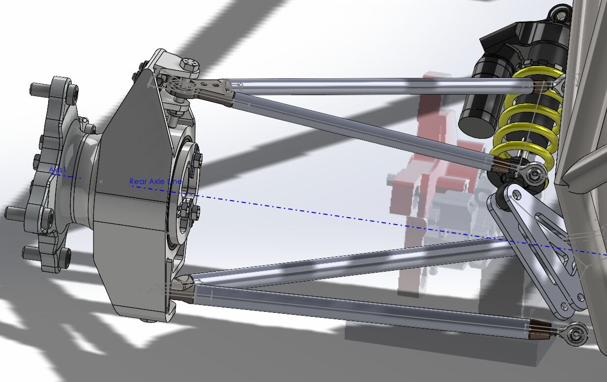</a>
      <figcaption>Formula SAE carbon-fiber arms</figcaption>
    </figure>
    <figure>
      <video src="/images/piv-fish-foil.mp4" poster="/images/projects/harvard/piv-video-poster.jpg" autoplay loop muted playsinline preload="metadata"></video>
      <figcaption>Flow imaging at Harvard’s Lauder Lab</figcaption>
    </figure>
  

I’m from Kokshetau, Kazakhstan, and I ski ⛷ and ride horses 🐎 whenever I get the chance — ideally in the Tian Shan mountains back home.

  <figure>
    <video src="/images/life-riding.mp4" poster="/images/life-riding-poster.jpg" autoplay loop muted playsinline preload="metadata"></video>
  </figure>
  <figure>
    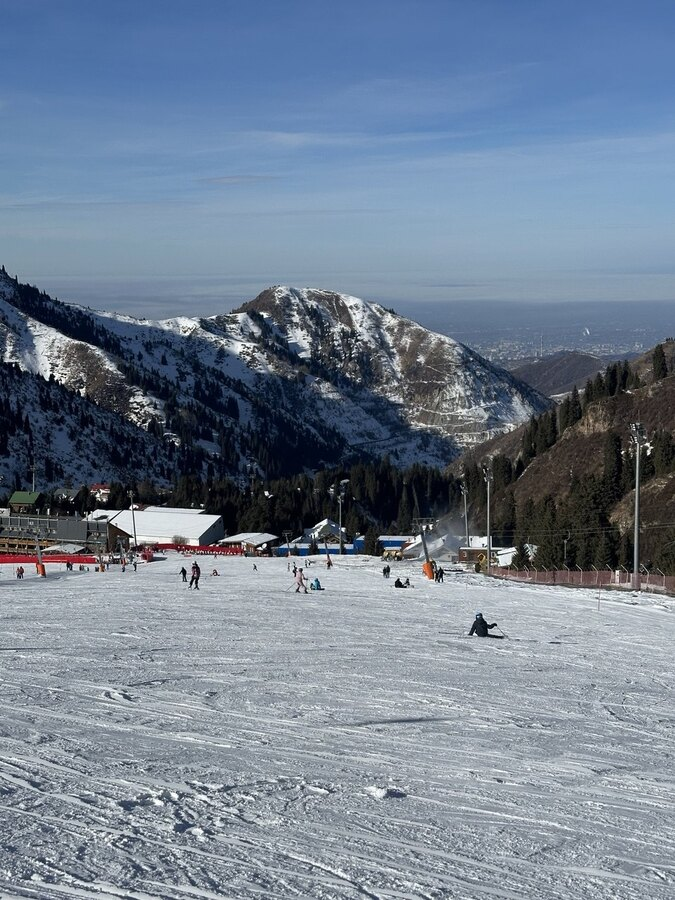
  </figure>
  <figure>
    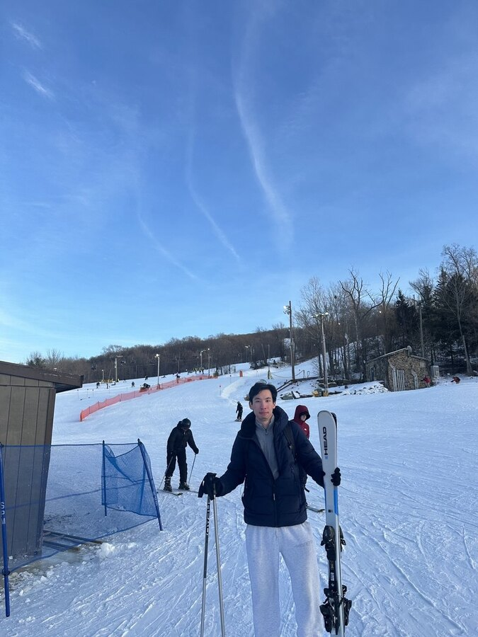
  </figure>

<h2 class="section-title">Featured projects <a class="section-title__more" href="/projects/">All projects &rarr;</a></h2>



<h2 class="section-title">News</h2>

> **November 2026:** 🎤 Presenting *"Passive Swimming Dynamics in a Thrust-Producing Vortex Wake"* at the [APS Division of Fluid Dynamics](https://www.aps.org/events/2026/dfd-annual-meeting-2026) meeting in Orlando, FL.

> **September 2026:** Presented the same work at the ONR MURI Annual Review Meeting at Lehigh University.

> **August 2026:** 🐟 Wrapped up my summer at the [Lauder Laboratory, Harvard University](https://sites.harvard.edu/glauder/), studying how fish gain thrust from the wake of a leading swimmer.

> **May 2026:** Started a summer research internship at the Lauder Laboratory, Harvard University, working on bio-inspired swimming and hydrodynamics 🎓.

> **December 2025:** Joined the Lehigh Formula SAE team as a Design and Manufacturing Engineer — carbon-fiber suspension control arms 🏎️.

> **November 2025:** 🏆 Won the [Best Undergraduate Research Poster Award](https://imece.secure-platform.com/a/solicitations/261/sessiongallery/21467/application/173171) at [ASME IMECE](https://event.asme.org/IMECE) for *"Design and Validation of a Cyber-Physical Fluid Dynamics System for Bio-Inspired Propulsion Studies."*

Earlier news

> **November 2025:** Presented *"Uncovering the Fluid–Structure Interactions of Wave-Assisted Propulsion via Cyber-Physical Fluid Dynamics"* at the [APS Division of Fluid Dynamics (DFD)](https://meetings-archive.aps.org/dfd/2025/s00/12/) in Houston, TX.

> **October 2025:** Presented WAP project progress at the Annual ONR MURI Meeting at Lehigh University.

> **May 2025:** Awarded the Rossin Research Fellowship to work in the Unsteady Flow Interactions Lab on cyber-physical systems for wave-assisted propulsion (WAP).

> **December 2024:** 🚀 Our team raised $200K in funding to build and launch [OSPREY](/projects/osprey-cubesat/), Lehigh's first nanosatellite 🛰️.

> **September 2024:** Started working on the [Bio-Inspired Riverine Power Generation Project](https://engineering.lehigh.edu/meche/research/featured-projects/bio-inspired-riverine-power-generation) 🌊.

> **August 2024:** Started a new position as MakerSpace Coordinator at Design Labs @ Lehigh University.

> **August 2024:** Presented *"Design and Implementation of a Dual-Axis Pitch and Heave Setup for Bio-Propulsion Studies"* at the Mountain Top Research Conference at Lehigh 🎤.

> **July 2024:** Started working with [Aerotargets International](http://www.aerotargets.com/) ✈️.

> **May 2024:** Awarded the STEM-SI Scholarship to work as an Undergraduate Research Intern over the summer 🏅.

> **April 2024:** Received the Michael Levin Advanced Technology Award for Best Technological Startup at Lehigh 🏆.

> **December 2023:** Began research at the [Unsteady Flow Interactions Laboratory](https://wordpress.lehigh.edu/kwm213/) 🔬.

> **November 2023:** Our team submitted the [first proposal](https://drive.google.com/file/d/1w6wW3RTmR0EpDcipo0eHy4nWQiP7tt0C/view) to the NASA CubeSat Launch Initiative to get funding and a spot on a SpaceX rocket to launch a satellite into space.

> **August 2023:** Started my Bachelor of Science in Mechanical Engineering at Lehigh University 👨‍💻.

> **June 2023:** Won a $5,000 grant and was recognized as a Top-3 SpaceTech Startup at the Central Asia Venture Forum 🚀.

> **May 2023:** Graduated from Nazarbayev Intellectual School of Physics and Mathematics in Kokshetau, Kazakhstan 🎓🇰🇿.

<h2 class="section-title">Experience</h2>

<ul class="timeline" markdown="0">
  <li>May – Aug 2026Research Intern<a href="https://sites.harvard.edu/glauder/">Lauder Laboratory, Harvard University</a> · Cambridge, MARobotic-fish experiments and flow imaging on how a swimmer gains thrust from a leader’s wake (ONR MURI program).</li>
  <li>Nov 2023 – presentUndergraduate Researcher — Mechanical Design &amp; Test<a href="https://wordpress.lehigh.edu/kwm213">Unsteady Flow Interactions Lab, Lehigh University</a> · Prof. Keith MooredDesigned and built the lab’s cyber-physical robotic flapper and run the experiments on it.</li>
  <li>Dec 2025 – presentDesign &amp; Manufacturing Engineer<a href="https://sites.google.com/lehigh.edu/lehighracing">Lehigh Formula SAE</a>Carbon-fiber suspension control arms — design, FEA, machining and testing.</li>
  <li>May – Aug 2024Mechanical Engineering Intern<a href="http://www.aerotargets.com/">Aerotargets International</a> · Kingston, PAWind-tunnel test program on a scaled target drone.</li>
  <li>Sep 2023 – Sep 2025Lead Mechanical Engineer, OSPREY CubeSatLehigh University Space InitiativeStructure, packaging and mass budget for Lehigh’s first satellite; led a team of six.</li>
  <li>Dec 2023 – presentHead Teaching Assistant, ENGR 010 · Makerspace Coordinator (2024–25)Lehigh UniversityWeekly Python and robotics labs for first-year engineers; ran the makerspace for a semester. <a href="/teach/">More &rarr;</a></li>
</ul>

<h2 class="section-title">Skills</h2>

  
<i class="fas fa-drafting-compass loop__icon" aria-hidden="true"></i>DesignSolidWorks · engineering drawings &amp; GD&amp;T · tolerance analysis · DFM/DFA · FMEA

  
<i class="fas fa-industry loop__icon" aria-hidden="true"></i>MakeCNC mill &amp; lathe · waterjet · laser cutting · 3D printing · composite bonding · injection molding

  
<i class="fas fa-microchip loop__icon" aria-hidden="true"></i>InstrumentNI DAQ · LabVIEW · force/torque sensors · encoders &amp; servos · Arduino · Raspberry Pi

  
<i class="fas fa-sliders-h loop__icon" aria-hidden="true"></i>Control &amp; codeMATLAB / Simulink · PID control · Python · C++ · R

  
<i class="fas fa-vial loop__icon" aria-hidden="true"></i>Analyze &amp; testANSYS FEA · test planning · wind tunnel &amp; water channel · Instron · PIV flow imaging

  <figure>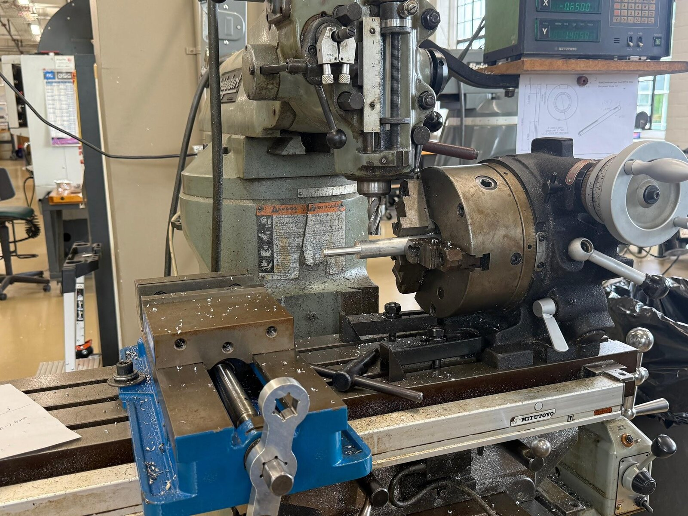<figcaption>Lathe &amp; mill</figcaption></figure>
  <figure>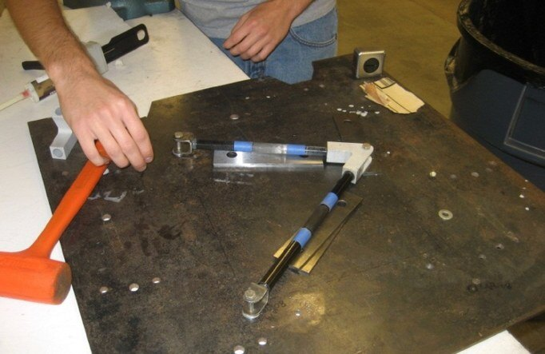<figcaption>Composite bonding</figcaption></figure>
  <figure>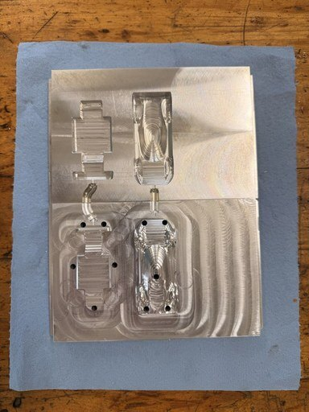<figcaption>Injection molding</figcaption></figure>
  <figure>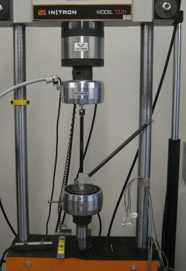<figcaption>Load testing</figcaption></figure>
  <figure>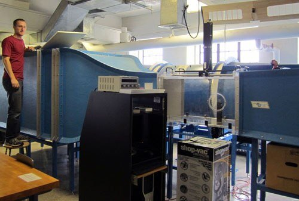<figcaption>Wind tunnel</figcaption></figure>
  <figure>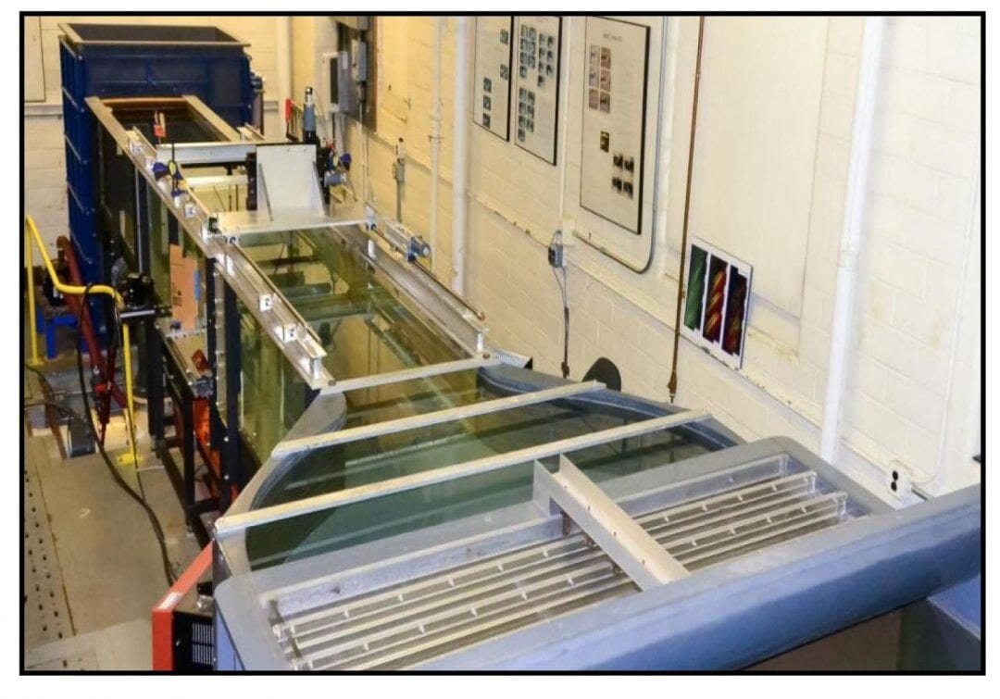<figcaption>Water channel</figcaption></figure>
  <figure>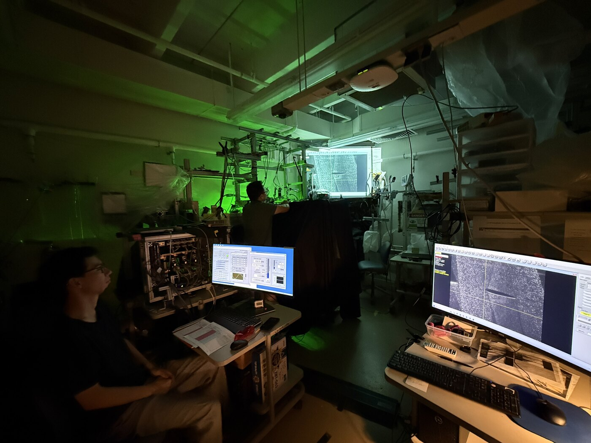<figcaption>PIV flow imaging</figcaption></figure>
  <figure>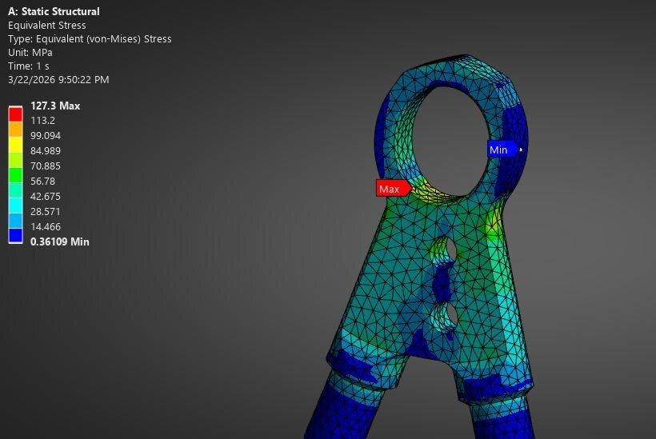<figcaption>FEA</figcaption></figure>

