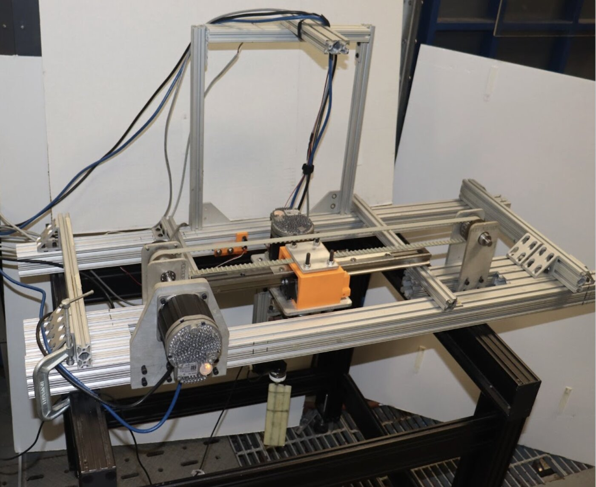
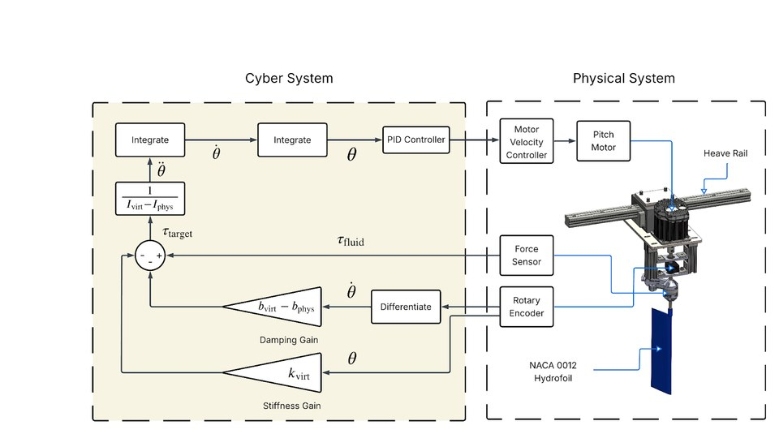
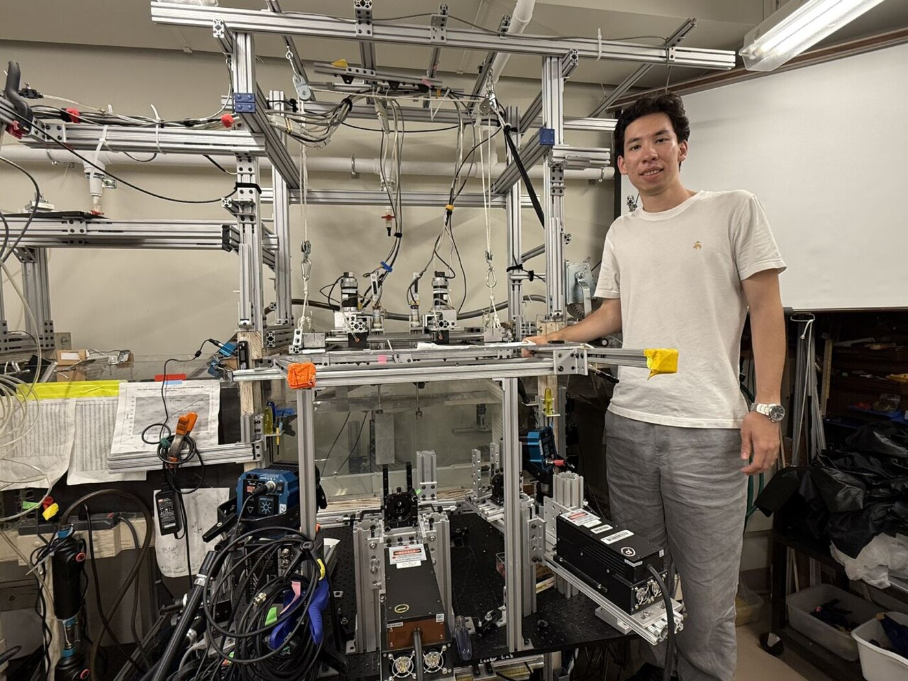
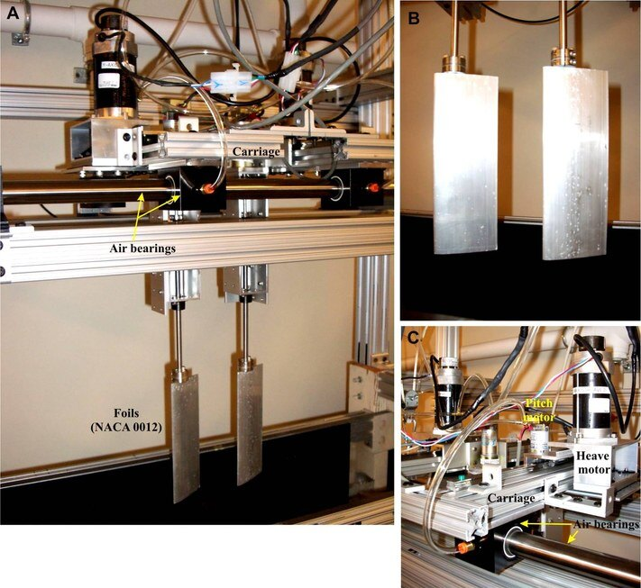
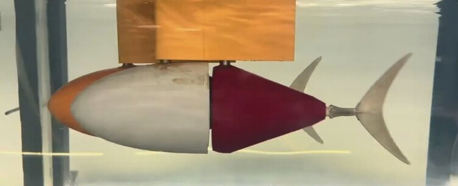
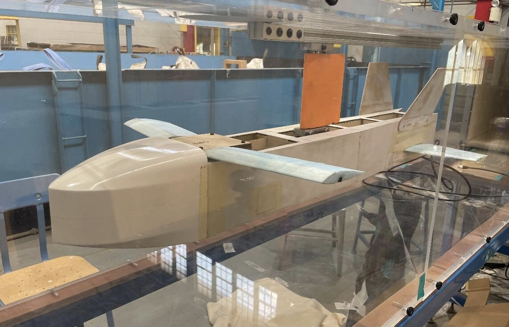
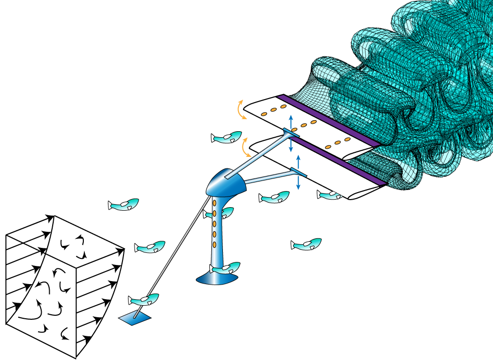
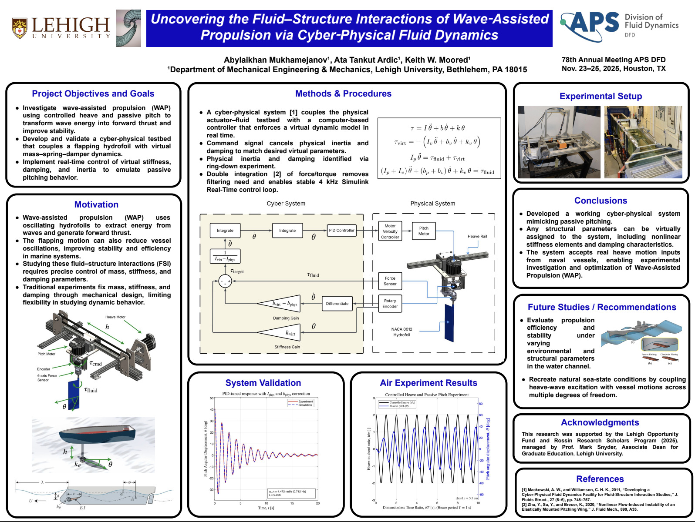

My research asks how fish swim — and what that can teach us about **more efficient ship propulsion**, **harvesting energy from ocean waves**, and **how swimmers save energy in groups**. The common thread is hardware: I build the robotic swimmers and test rigs that make the experiments possible, then run them.

I've done this for three years at the [Unsteady Flow Interactions Laboratory](https://wordpress.lehigh.edu/kwm213) at Lehigh with [Dr. Keith Moored](https://engineering.lehigh.edu/faculty/keith-w-moored), and at the [Lauder Laboratory](https://sites.harvard.edu/glauder/) at Harvard with [Dr. George Lauder](https://www.oeb.harvard.edu/people/george-v-lauder), both under Office of Naval Research programs. Here is how it has built up, one step at a time.

  

    <figure></figure>
    

      <h3><a href="/projects/cyber-physical-robotic-flapper/">I built a pitch-and-heave robotic flapper</a></h3>
      
A two-axis rig that moves a foil through the Lehigh water channel like a fish tail — heaving up and down while pitching — and measures the forces on it. Designed in CAD, machined in-house, wired and programmed by me.

    

  

  

    <figure></figure>
    

      <h3><a href="/projects/cyber-physical-robotic-flapper/">Then I made it cyber-physical: a spring that lives in software</a></h3>
      
Instead of mounting a real spring on the foil, the control loop reads the force sensors and solves a mass–spring–damper equation in real time, and the motor moves the foil exactly as if that spring were there. Any stiffness, damping or mass can be set with a keystroke — no new parts, no rebuilding. It won the Best Undergraduate Poster Award at ASME IMECE 2025.

    

  

  

    <figure></figure>
    

      <h3><a href="/projects/harvard-inline-swimming/">At Harvard, we tested in-line swimming</a></h3>
      
A robotic flapper makes a wake and a fish-shaped body sits behind it — and the follower gets pushed along without swimming at all. I ran the experiments and imaged the flow with PIV to see the vortices doing the work.

    

  

  

    <figure></figure>
    

      <h3><a href="/projects/harvard-inline-swimming/">We tested the Knoller–Betz effect with two foils, then with 3-D printed fish</a></h3>
      
The Knoller–Betz effect is why a flapping wing or tail produces thrust. We measured it first with a trailing foil behind the flapper, then with passive fish bodies, to see when and how a follower harvests energy from the wake ahead of it.

    

  

  

    <figure></figure>
    

      <h3><a href="/projects/tunabot-inline-swimming/">Back at Lehigh, two robotic tuna swim in line</a></h3>
      
Two TunaBot robots on independent carriages, so we can set their spacing and the timing between their tail beats, with PIV capturing the wake between them. The same question, now with both fish actively swimming.

    

  

  

    <figure></figure>
    

      <h3><a href="/projects/aerotargets-wind-tunnel/">In between, wind-tunnel work in the same lab</a></h3>
      
A three-phase test program on a target drone for Aerotargets International, and an aeroelastic wing study tested to failure — same instruments, air instead of water.

    

  

  

    <figure></figure>
    

      <h3>Where this is going</h3>
      
We're now looking at combining the Knoller–Betz effect with wave-assisted propulsion — using the cyber-physical rig to work out how a vehicle could swim with bio-inspired propulsion and pick up those benefits from the waves and wakes around it.

    

  

## Presentations & awards

- **APS Division of Fluid Dynamics 2026**, Orlando, FL (Nov 2026) — *Passive Swimming Dynamics in a Thrust-Producing Vortex Wake* (with G. Lauder and K. Moored) — presenting.
- **ONR MURI Annual Review**, Lehigh University (Sep 2026) — *Passive Swimming Dynamics in a Thrust-Producing Vortex Wake*.
- **Rossin Research Scholar Symposium**, Lehigh University (Jan 2026) — *Uncovering the Fluid–Structure Interactions of Wave-Assisted Propulsion via Cyber-Physical Fluid Dynamics*.
- **ASME IMECE 2025**, Memphis, TN (Nov 2025) — *Design and Validation of a Cyber-Physical Fluid Dynamics System for Bio-Inspired Propulsion Studies* (with A. Ardıç and K. Moored) — **Best Undergraduate Research Poster Award**. [Session details](https://imece.secure-platform.com/a/solicitations/261/sessiongallery/21467/application/173171)
- **APS Division of Fluid Dynamics 2025**, Houston, TX (Nov 2025) — *Uncovering the Fluid–Structure Interactions of Wave-Assisted Propulsion via Cyber-Physical Fluid Dynamics* (with A. Ardıç and K. Moored). [Session details](https://meetings-archive.aps.org/dfd/2025/s00/12/)
- **ONR MURI Annual Meeting**, Lehigh University (Oct 2025) — WAP project progress: experimental validation and control integration of the cyber-physical testbed.
- **Mountain Top Research Conference**, Lehigh University (Aug 2024) — *Design and Implementation of a Dual-Axis Pitch and Heave Setup for Bio-Propulsion Studies*.
- A journal paper on the Harvard in-line swimming work (with the Harvard and Lehigh groups) is in preparation.

<figure class="figure-wide">
  
  <figcaption>The ASME IMECE 2025 poster. Click to enlarge.</figcaption>
</figure>

## Earlier: nano/human interfaces

In my first year I worked with Lehigh's Nano/Human Interfaces Presidential Initiative, turning atomic-force-microscopy scans of [perovskite solar cells](https://nhi.lehigh.edu/projects/perovskite-solar-cell-surface) into 3-D models you can explore in augmented reality. [Project page &rarr;](/projects/perovskite-ar-visualization/)
