Most of my projects run the whole way from a CAD model to a working, tested piece of hardware, so I've picked up tools at every step along the way.

  
<i class="fas fa-drafting-compass loop__icon" aria-hidden="true"></i>DesignSolidWorks · engineering drawings &amp; GD&amp;T · tolerance analysis · DFM/DFA · FMEA

  
<i class="fas fa-industry loop__icon" aria-hidden="true"></i>MakeCNC mill &amp; lathe · waterjet · laser cutting · 3D printing · composite bonding · injection molding

  
<i class="fas fa-microchip loop__icon" aria-hidden="true"></i>InstrumentNI DAQ · LabVIEW · force/torque sensors · encoders &amp; servos · Arduino · Raspberry Pi

  
<i class="fas fa-sliders-h loop__icon" aria-hidden="true"></i>Control &amp; codeMATLAB / Simulink · PID control · Python · C++ · R

  
<i class="fas fa-vial loop__icon" aria-hidden="true"></i>Analyze &amp; testANSYS FEA · test planning · wind tunnel &amp; water channel · Instron · PIV flow imaging

  <figure><a class="tile-img" href="/images/projects/cpfd/rig-photo.jpg" title="Mechatronics &amp; control &mdash; Cyber-physical flapper">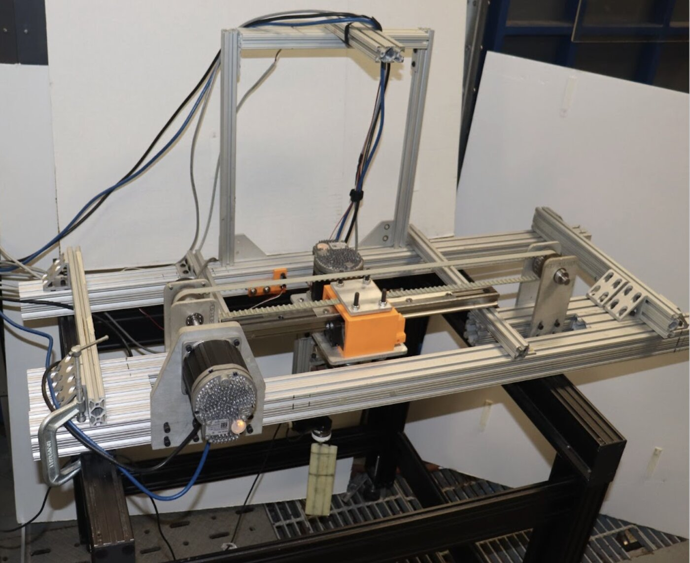</a><figcaption>Mechatronics &amp; control<a class="tile-link" href="/projects/cyber-physical-robotic-flapper/">Cyber-physical flapper &rarr;</a></figcaption></figure>
  <figure><a class="tile-img" href="/images/projects/osprey/render-deployed.jpg" title="CAD &amp; packaging &mdash; OSPREY CubeSat">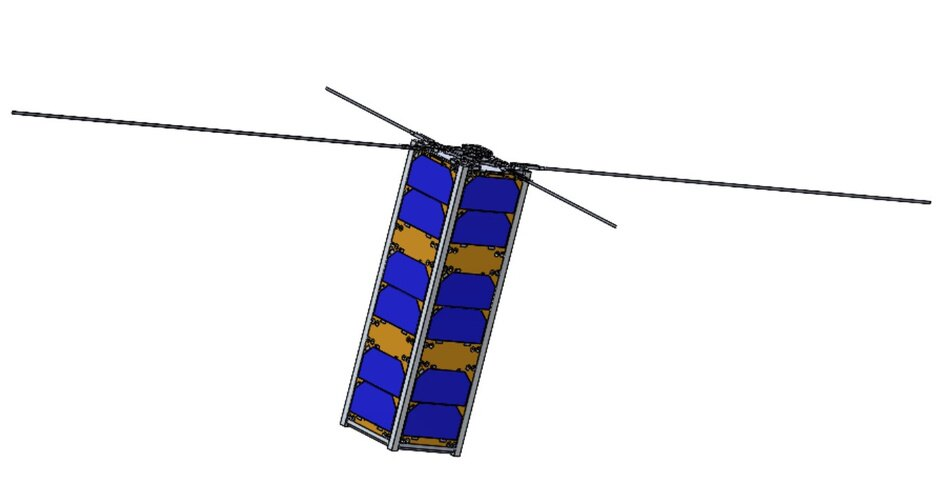</a><figcaption>CAD &amp; packaging<a class="tile-link" href="/projects/osprey-cubesat/">OSPREY CubeSat &rarr;</a></figcaption></figure>
  <figure><a class="tile-img" href="/images/projects/fsae/connector-fea.jpg" title="FEA &mdash; Formula SAE control arms">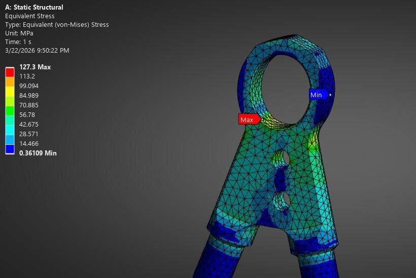</a><figcaption>FEA<a class="tile-link" href="/projects/fsae-carbon-fiber-control-arms/">Formula SAE control arms &rarr;</a></figcaption></figure>
  <figure><a class="tile-img" href="/images/projects/fsae/lathe.jpg" title="Lathe &amp; mill &mdash; Formula SAE control arms">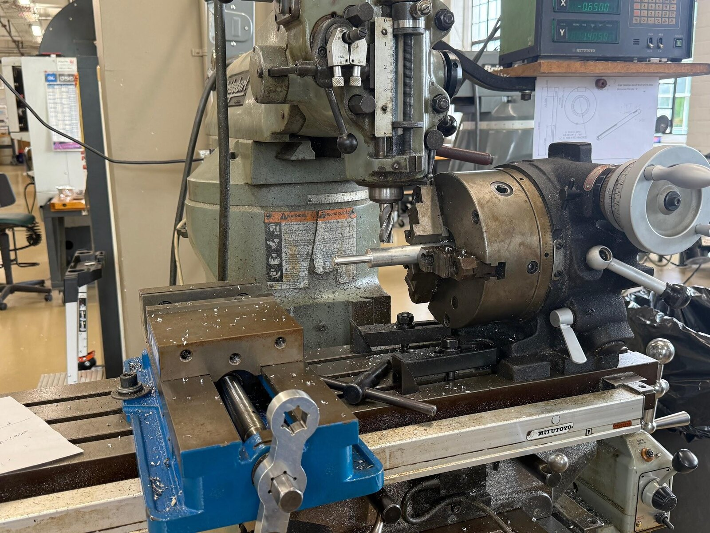</a><figcaption>Lathe &amp; mill<a class="tile-link" href="/projects/fsae-carbon-fiber-control-arms/">Formula SAE control arms &rarr;</a></figcaption></figure>
  <figure><a class="tile-img" href="/images/projects/injection/mold-machined.jpg" title="Injection molding &mdash; Injection-molded race car">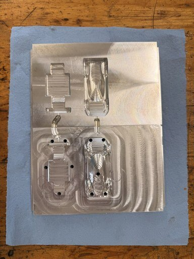</a><figcaption>Injection molding<a class="tile-link" href="/projects/injection-molded-race-car/">Injection-molded race car &rarr;</a></figcaption></figure>
  <figure><a class="tile-img" href="/images/projects/fsae/instron.jpg" title="Load testing &mdash; Formula SAE control arms">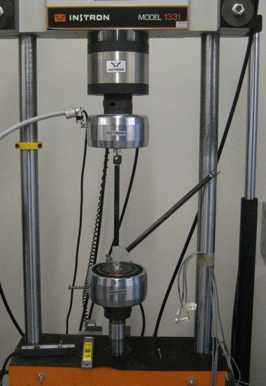</a><figcaption>Load testing<a class="tile-link" href="/projects/fsae-carbon-fiber-control-arms/">Formula SAE control arms &rarr;</a></figcaption></figure>
  <figure><a class="tile-img" href="/images/projects/fsae/bonding.jpg" title="Composite bonding &mdash; Formula SAE control arms">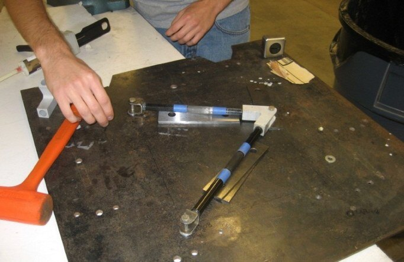</a><figcaption>Composite bonding<a class="tile-link" href="/projects/fsae-carbon-fiber-control-arms/">Formula SAE control arms &rarr;</a></figcaption></figure>
  <figure><a class="tile-img" href="/images/projects/skillsat/kit-demo.jpg" title="3D printing &mdash; SkillSat">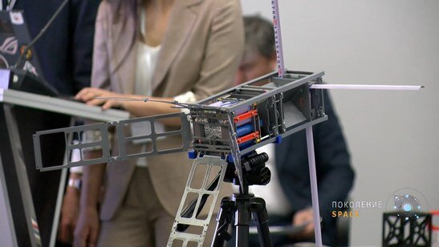</a><figcaption>3D printing<a class="tile-link" href="/projects/skillsat/">SkillSat &rarr;</a></figcaption></figure>
  <figure><a class="tile-img" href="/images/projects/wing/wing-build.jpg" title="Laser cutting &mdash; Aeroelastic wing">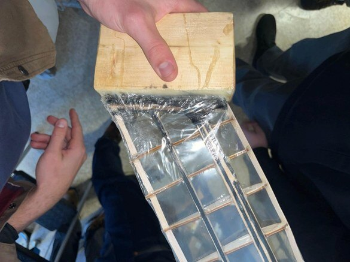</a><figcaption>Laser cutting<a class="tile-link" href="/projects/aeroelastic-wing/">Aeroelastic wing &rarr;</a></figcaption></figure>
  <figure><a class="tile-img" href="/images/projects/aerotargets/wind-tunnel.jpg" title="Wind tunnel &mdash; Aerotargets wind tunnel">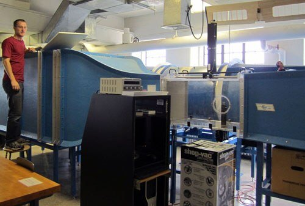</a><figcaption>Wind tunnel<a class="tile-link" href="/projects/aerotargets-wind-tunnel/">Aerotargets wind tunnel &rarr;</a></figcaption></figure>
  <figure><a class="tile-img" href="/images/projects/cpfd/water-channel.jpg" title="Water channel &mdash; Cyber-physical flapper">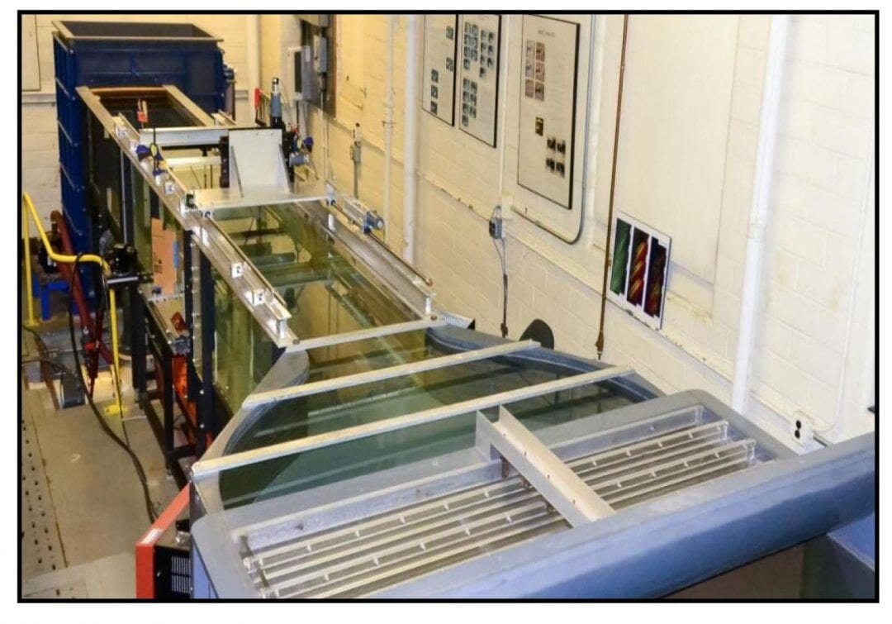</a><figcaption>Water channel<a class="tile-link" href="/projects/cyber-physical-robotic-flapper/">Cyber-physical flapper &rarr;</a></figcaption></figure>
  <figure><a class="tile-img" href="/images/projects/harvard/piv-lab.jpg" title="PIV flow imaging &mdash; Harvard in-line swimming">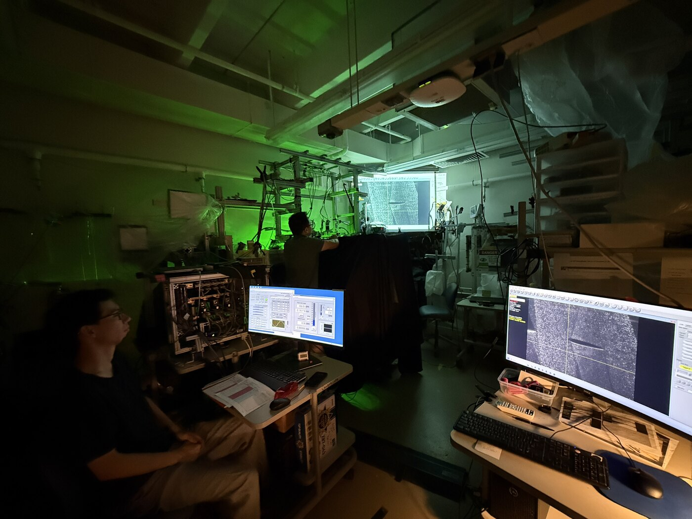</a><figcaption>PIV flow imaging<a class="tile-link" href="/projects/harvard-inline-swimming/">Harvard in-line swimming &rarr;</a></figcaption></figure>

Click a photo to see it large; the small link on each tile goes to the project it came from.

