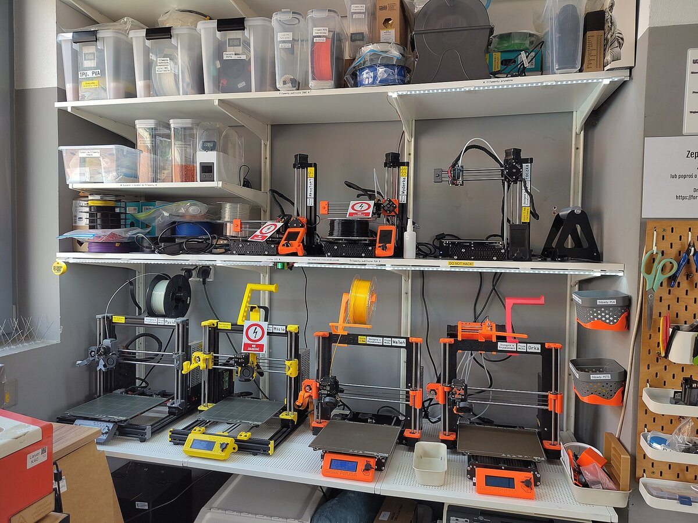
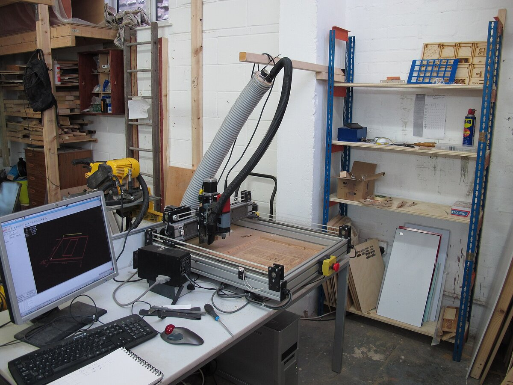
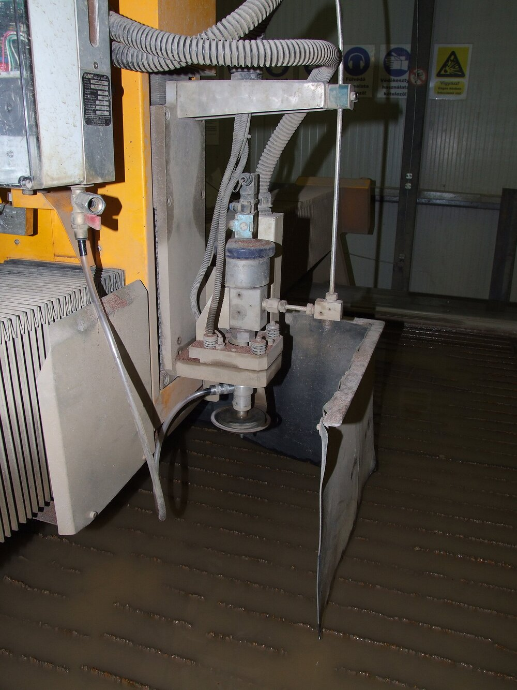
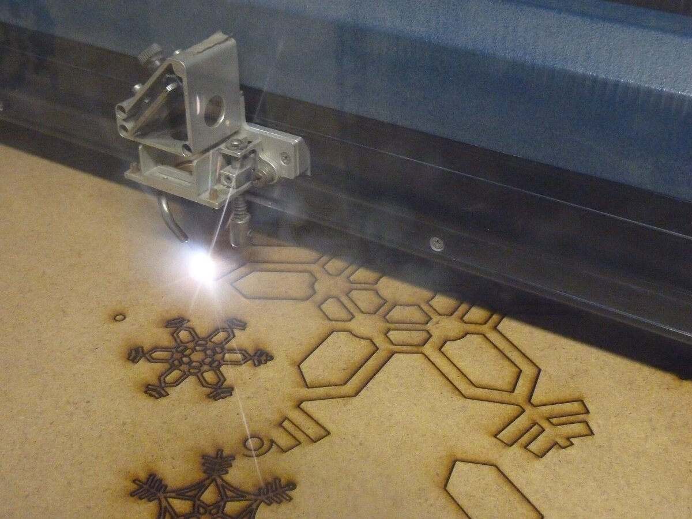

I started as a TA in my own first year and have helped run the lab side of Lehigh's first-year engineering course ever since. It's where I learned to explain a sensor or a control loop in plain words — which turns out to be useful with teammates, machinists and everyone else too.

## Head Teaching Assistant — ENGR 010, Applied Engineering Computer Methods
*Lehigh University · TA since Spring 2024 · Head TA since Spring 2025*

  

    <ul>
      <li>Lead a section of 30–40 first-year students through weekly Python and robotics labs; the course has about 300 students a semester.</li>
      <li>Wrote eight hands-on robotics lab modules with micro:bit and Arduino — sensors, motors and simple control logic — that the course still runs every semester.</li>
      <li>Coordinate the other TAs in my section so grading stays consistent, fix hardware live during labs, and help new TAs find their feet.</li>
    </ul>
  

  <figure class="figure-wide"><video src="/images/robotics-lab.mp4" poster="/images/projects/teaching/robot-video-poster.jpg" autoplay loop muted playsinline preload="metadata"></video><figcaption>One of the lab robots on the move.</figcaption></figure>

## Makerspace Coordinator — Design Labs
*Lehigh University · Aug 2024 – Jan 2025*

For a semester I ran the student makerspace ten hours a week, helping students and clubs get their designs made on the right machine — 3D printers, CNC routers, waterjet and laser cutters — for 30-odd projects. Picking the manufacturing process *before* finishing the design is a habit I picked up here and still use on every part I draw.

  <figure><figcaption>3D printers</figcaption></figure>
  <figure><figcaption>CNC router</figcaption></figure>
  <figure><figcaption>Waterjet cutter</figcaption></figure>
  <figure><figcaption>Laser cutter</figcaption></figure>

Equipment photos via Wikimedia Commons: <a href="https://commons.wikimedia.org/wiki/File:3D_printer_farm_at_Hackerspace_Wroc%C5%82aw.jpg">Majabojarska</a> (CC BY 4.0), <a href="https://commons.wikimedia.org/wiki/File:CNC_router_in_workshop.jpg">matthew venn</a> (CC BY-SA 2.0), <a href="https://commons.wikimedia.org/wiki/File:Water_jet_cutter%27s_head.jpg">Márton Kiss-Albert</a> (CC BY-SA 3.0), <a href="https://commons.wikimedia.org/wiki/File:Laser_cutting_snowflakes.jpg">Andy Dingley</a> (CC BY-SA 3.0).

## Elsewhere

- Wrote the operating tutorial and added the safety limits that let other lab members run the [robotic flapper](/projects/cyber-physical-robotic-flapper/) on their own.
- Led the six-person mechanical team on [OSPREY](/projects/osprey-cubesat/), Lehigh's first CubeSat.
- Through [SkillSat](/projects/skillsat/), put satellite-building kits in the hands of 240+ students across 25+ schools in Kazakhstan.
