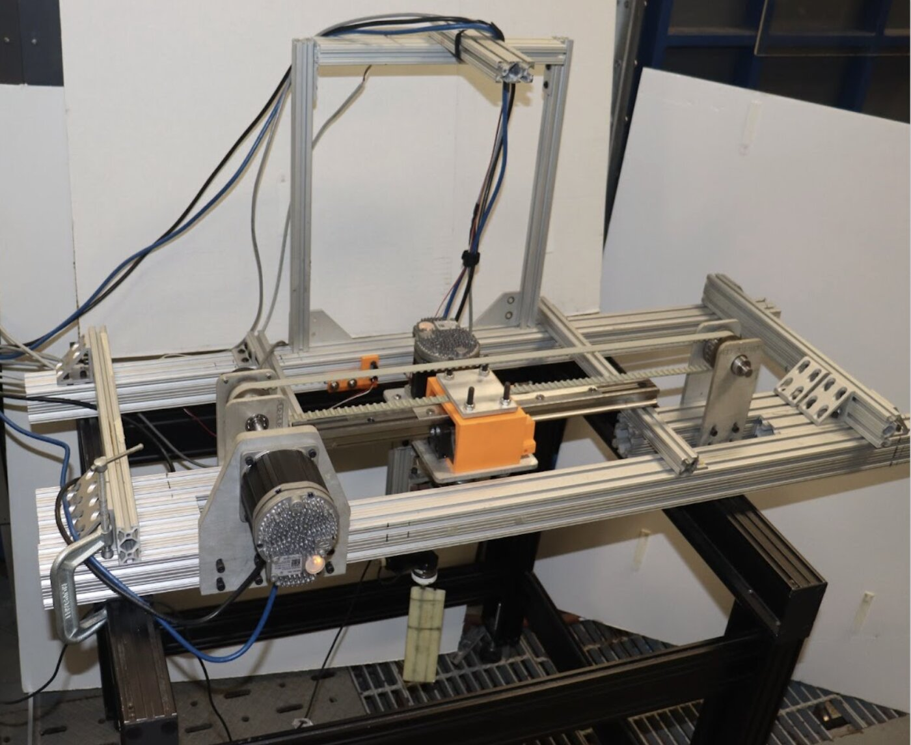
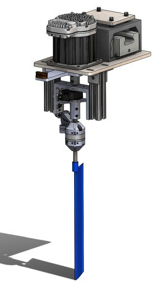
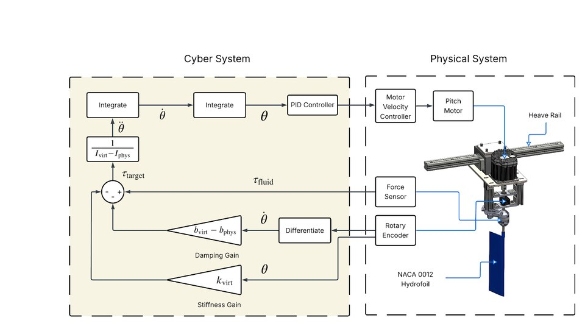
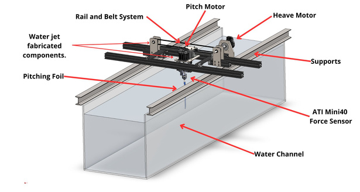
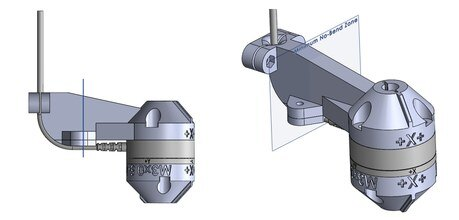
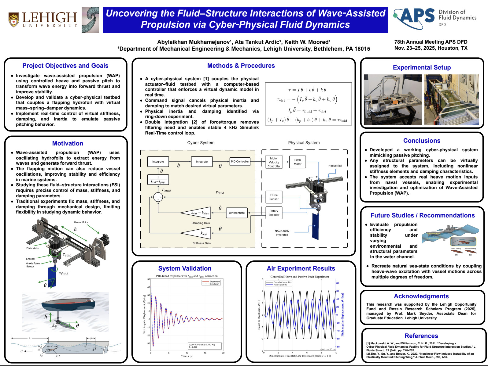

Our lab studies how the motion of ocean waves can be turned into thrust — the same physics that lets a fish push itself forward with its tail. To do that experimentally you need a foil that pitches and heaves in a water channel with exactly known mass, stiffness and damping. The old way to change any of those was to physically swap springs and foils and reassemble the hardware, which took about half an hour each time.

This is the rig I designed and built to replace that process, from the first CAD model to the control code that runs it today.

  <figure><video src="/images/cpfd-testbed.mp4" poster="/images/projects/cpfd/rig-video-poster.jpg" autoplay loop muted playsinline preload="metadata"></video><figcaption>The rig running a pitch-and-heave sweep in the channel.</figcaption></figure>
  <figure><figcaption>The finished rig on the Lehigh water channel.</figcaption></figure>
  <figure><figcaption>The pitch stack: motor, encoder, force sensor, foil.</figcaption></figure>

## What I did

- Designed the whole two-axis mechanism in SolidWorks — about 45 custom parts — and made them in-house by CNC machining, waterjet cutting and 3D printing.
- Wired up the motors, encoders and a six-axis force sensor through an NI DAQ into a real-time MATLAB/Simulink control loop.
- Made the rig *cyber-physical*: the force sensor measures the water pushing on the foil, the controller works out how a foil with the programmed mass, spring and damper would respond, and the motor moves it exactly that way. The "spring" now lives in software, so changing it takes seconds.
- Automated the experiments so the rig runs whole parameter sweeps on its own and saves every data set, with emergency stops, motion limits and an operating tutorial so other lab members can use it safely.

<figure class="figure-wide">
  
  <figcaption>How the virtual spring works: the measured fluid force feeds a mass–spring–damper model that the motor then tracks, 4,000 times a second.</figcaption>
</figure>

## How it turned out

The lab went from roughly eight experiments a day to about thirty, without buying a new spring for every test, and the rig can even replay the heave motion of a real ship. The work won the **Best Undergraduate Research Poster Award at ASME IMECE 2025** and has been presented at the APS Division of Fluid Dynamics and at ONR program reviews.

My favorite problem along the way: the foil wasn't tracking its commanded motion, and tuning the controller didn't fix it. Comparing the motor's position with an external encoder showed the motor turning while the foil lagged behind — a mechanical clearance in the drive, not a control issue. I redesigned those joints as press fits and rebuilt the linear drive, and the tracking error dropped five-fold. Measure the mechanism before you tune the controller.

  <figure><figcaption>The main pieces: rail and belt, pitch and heave motors, waterjet-cut supports, force sensor.</figcaption></figure>
  <figure><figcaption>Where the foil meets the force sensor.</figcaption></figure>
  <figure><figcaption>The IMECE 2025 poster (click to enlarge).</figcaption></figure>

