Weight on the wheels costs grip, and our Formula SAE car was carrying steel suspension arms. A suspension link only ever pushes or pulls along its length, and for that job a carbon-fiber tube beats steel by a wide margin per kilogram. The hard part is the joint: how do you glue a carbon tube into an aluminum connector so it survives braking, cornering and the occasional curb, race after race? Other teams had tried and failed right at that joint, so that's where most of our work went.

<figure class="figure-wide">
  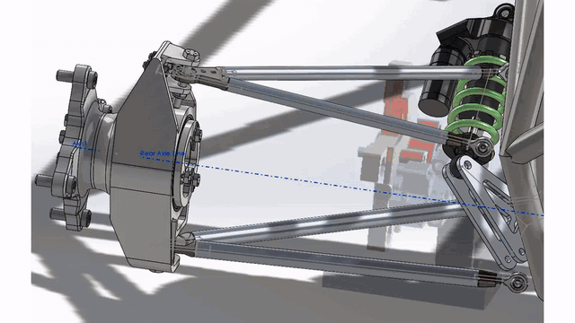
  <figcaption>From the suspension CAD to the carbon tube, the bonded connector, FEA, machining, and the car on track.</figcaption>
</figure>

## What I did

- Designed aluminum connectors that bond into the carbon tubes with structural epoxy. The connector and tube diameters set the glue-line thickness by geometry, so every joint comes out the same no matter who assembles it. An O-ring keeps moisture out and a cross-pin backs up the bond.
- Sized the joints in ANSYS for the braking and cornering loads to a safety factor of two, checked the first vibration mode sits far above anything the road produces, and wrote the team's failure-modes analysis for the arm.
- Machined the connectors in our shop on the lathe and mill, holding the tolerances on the bonding and sealing surfaces.
- Wrote a 45-specimen test program (bond type, overlap length, surface treatment) so the team could settle a design disagreement with data instead of opinions.

  <figure><a href="/images/projects/fsae/connector-cad-1.jpg">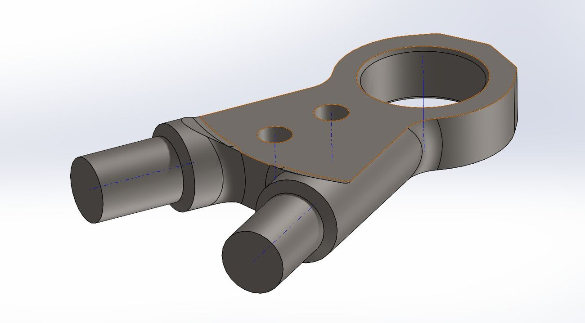</a><figcaption>The aluminum connector — same geometry as the steel original, with inserts for the carbon tubes.</figcaption></figure>
  <figure><a href="/images/projects/fsae/insert-cross-section.jpg">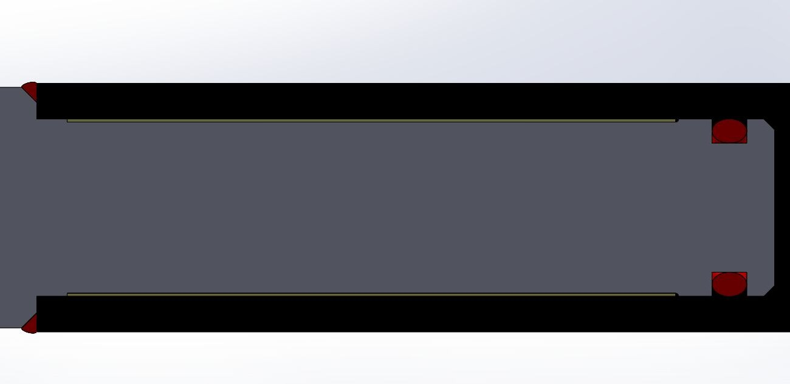</a><figcaption>Inside the joint: a controlled glue gap and an O-ring seal.</figcaption></figure>
  <figure><a href="/images/projects/fsae/connector-fea.jpg">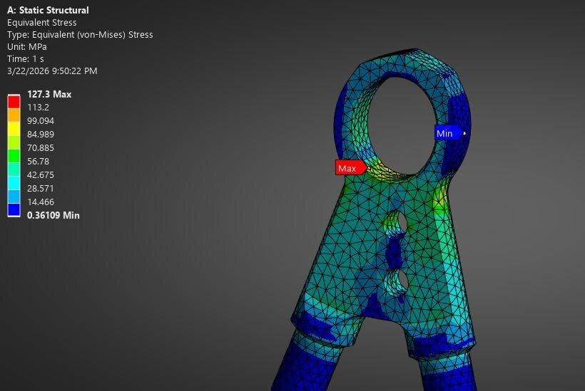</a><figcaption>Stress in the connector at the design load.</figcaption></figure>
  <figure><a href="/images/projects/fsae/lathe.jpg">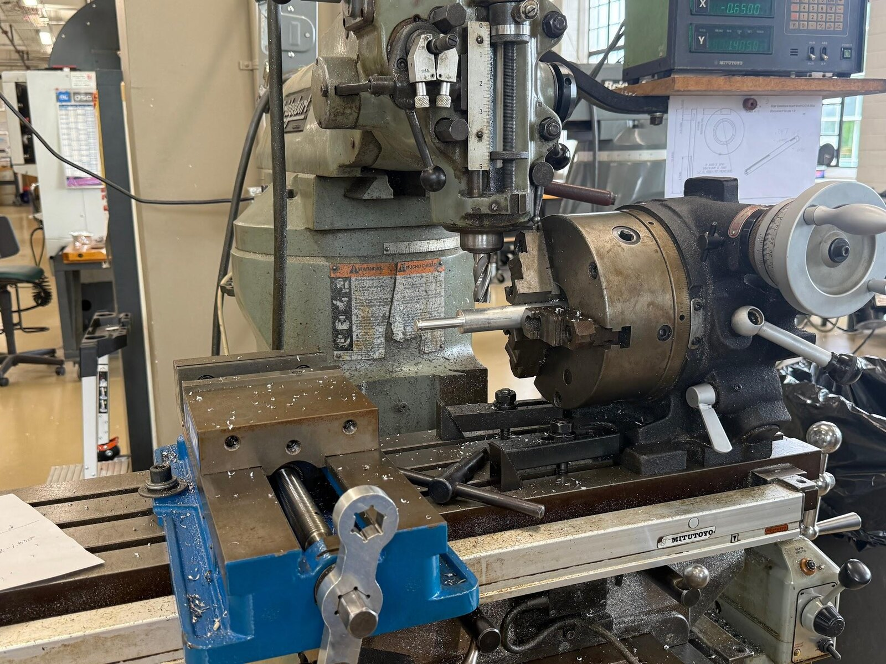</a><figcaption>Turning a test insert in the Lehigh shop.</figcaption></figure>
  <figure><a href="/images/projects/fsae/insert-drawing.png">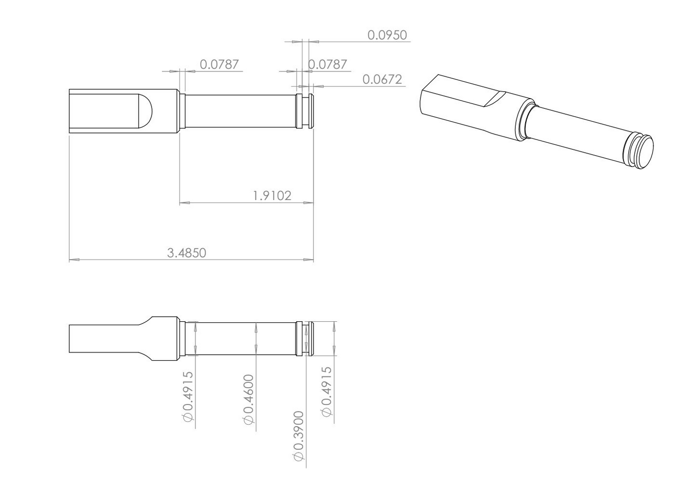</a><figcaption>The test-insert drawing.</figcaption></figure>
  <figure><a href="/images/projects/fsae/connector-modal.jpg">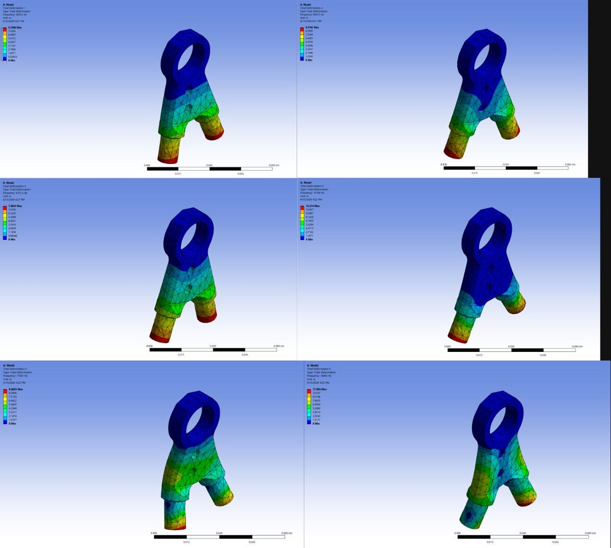</a><figcaption>Vibration modes of the connector.</figcaption></figure>

## Where it stands

By design the carbon arms come out nearly half the weight of the steel ones — roughly four kilograms off the car. The connectors are machined, and the bonded test specimens are being pulled on the Instron this fall; those results pick the final connector design and surface treatment before the arms go on the car.

  <figure class="figure-wide">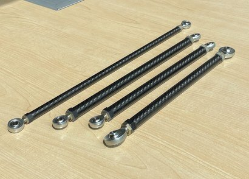<figcaption>Carbon tubes with rod ends — the team's earlier purchased rods, our baseline.</figcaption></figure>
  <figure class="figure-wide">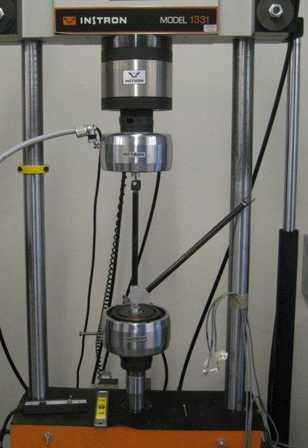<figcaption>The Instron where the bonded specimens get pulled.</figcaption></figure>

  <figure><a href="/images/projects/fsae/car-track.jpg">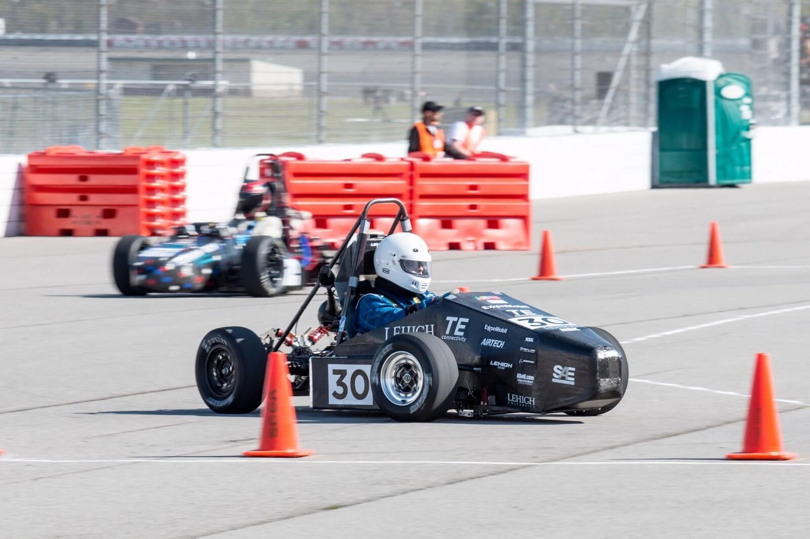</a><figcaption>The car on course.</figcaption></figure>
  <figure><a href="/images/projects/fsae/car-front.jpg">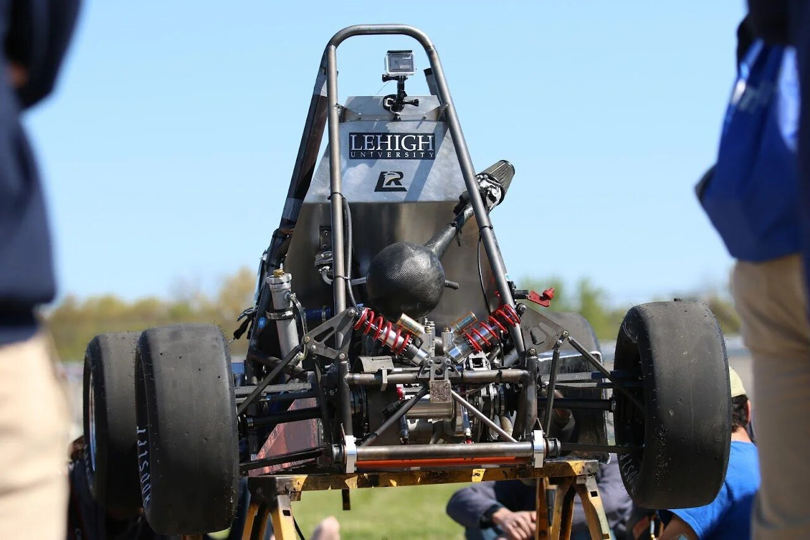</a><figcaption>Front suspension on the current car.</figcaption></figure>

