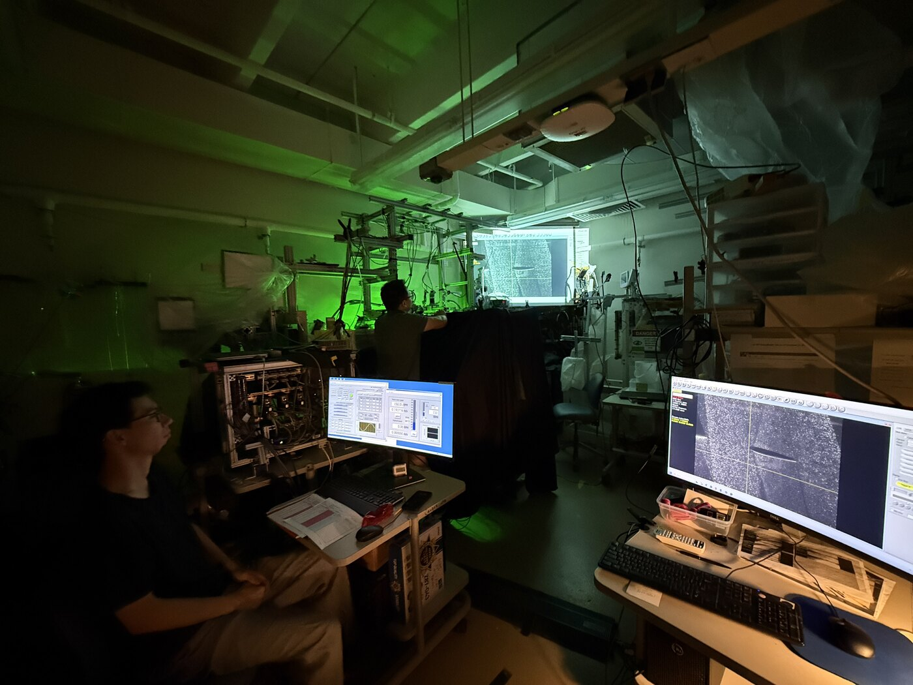
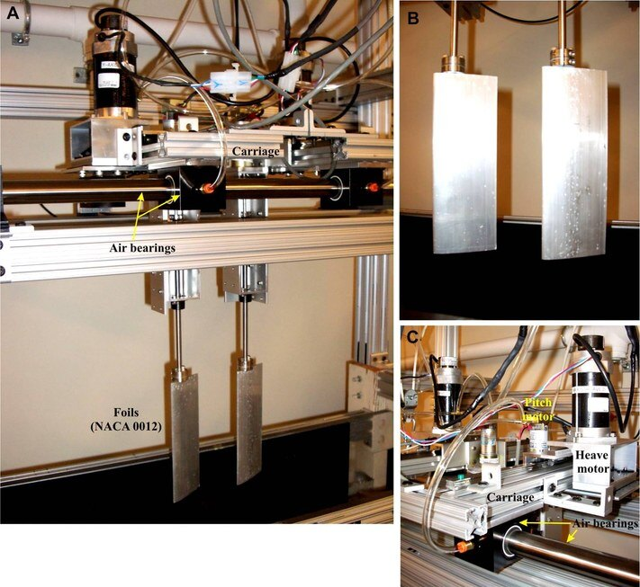
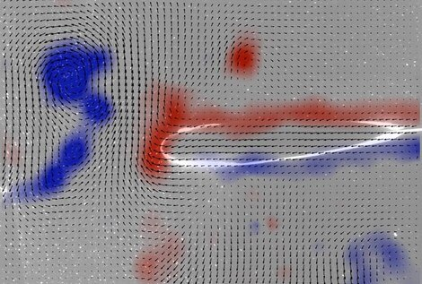
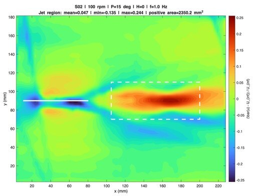
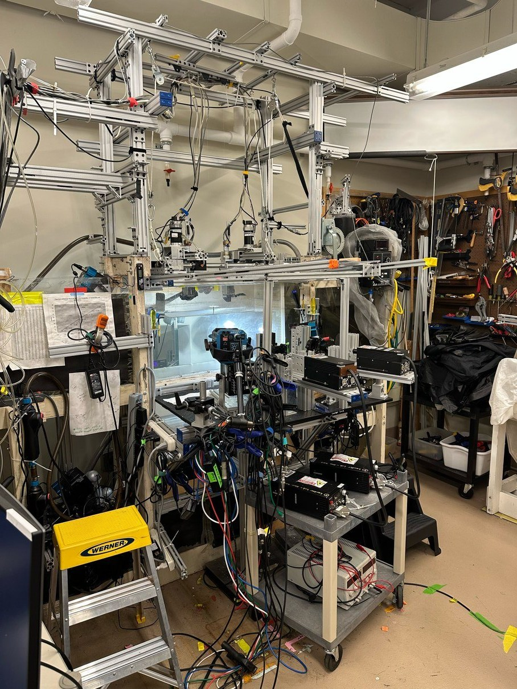

Fish in schools save energy by riding the wakes of the fish ahead of them. If we understand exactly how, ships and underwater drones travelling in groups could do the same. At Harvard I worked on the simplest version of the question: a robotic flapper makes a wake, a passive fish-shaped body sits behind it — when does the follower get pushed forward without swimming at all?

## What I did

- Ran the lab's air-bearing robotic swimmer — it floats on a cushion of air, so even tiny forces show up as motion — and planned a test matrix over flapping frequency, amplitude and flow speed instead of changing one setting at a time.
- Mapped the flow with particle image velocimetry (PIV): a laser sheet lights up particles in the water and a camera tracks them, which shows the vortices the leader leaves behind and how they hit the follower.
- Built the tracking pipelines in MATLAB and R that turn the video into numbers, and wrote the technical report at the end of the summer.

  <figure class="figure-wide"><video src="/images/piv-fish-foil.mp4" poster="/images/projects/harvard/piv-video-poster.jpg" autoplay loop muted playsinline preload="metadata"></video><figcaption>PIV of the leading foil and the trailing fish — red and blue mark the two spins of the vortices.</figcaption></figure>
  <figure class="figure-wide"><video src="/images/tracking-points.mp4" autoplay loop muted playsinline preload="metadata"></video><figcaption>Tracked points on the raw footage: the foil in blue, the fish in orange.</figcaption></figure>

## How it turned out

Two things came out of the summer. First, a sweet spot: the combinations of flapping frequency, amplitude and spacing where a trailing body gets a real push from the wake — settings the robotic-fish experiments can now use directly. Second, the follower barely has to work for it: a passive fish settles into a stable position in the wake on its own, moving with the flow rather than fighting it, and still collects the benefit. I presented the results at the ONR program review in September 2026 and am presenting them at the APS Division of Fluid Dynamics meeting in November; a journal paper with the Harvard and Lehigh groups is in the works.

  <figure><figcaption>Running PIV — the green sheet is the laser.</figcaption></figure>
  <figure><figcaption>The air-bearing carriage and foils.</figcaption></figure>
  <figure><figcaption>The vortex wake behind the foil.</figcaption></figure>
  <figure><figcaption>Averaged over time, the wake is a jet — that's the thrust.</figcaption></figure>
  <figure class="contain"><figcaption>The flume, cameras and laser optics.</figcaption></figure>

