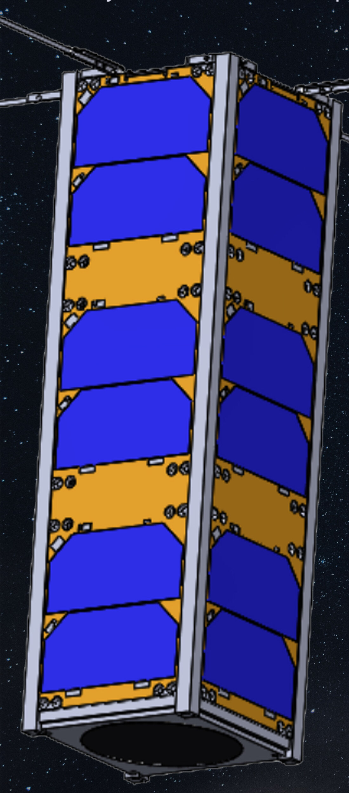
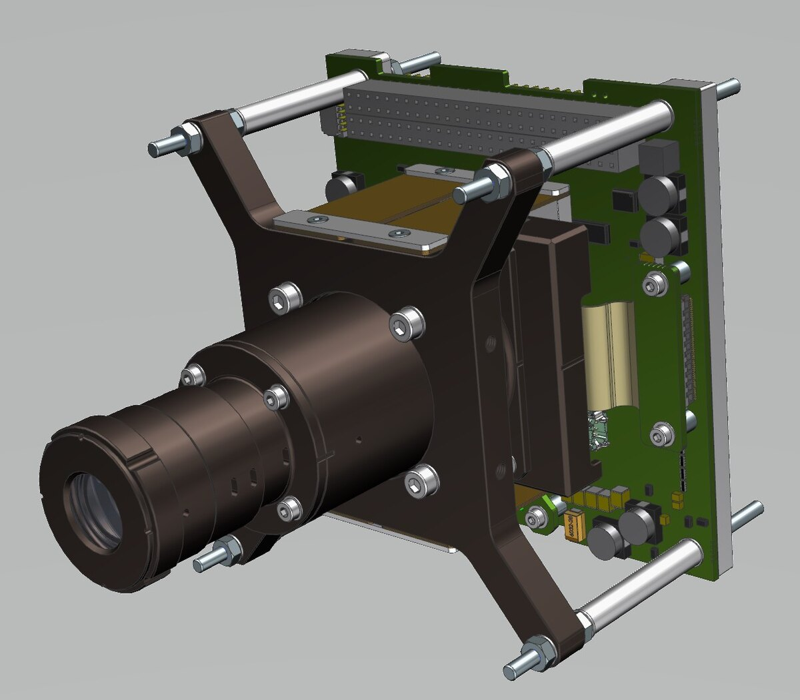
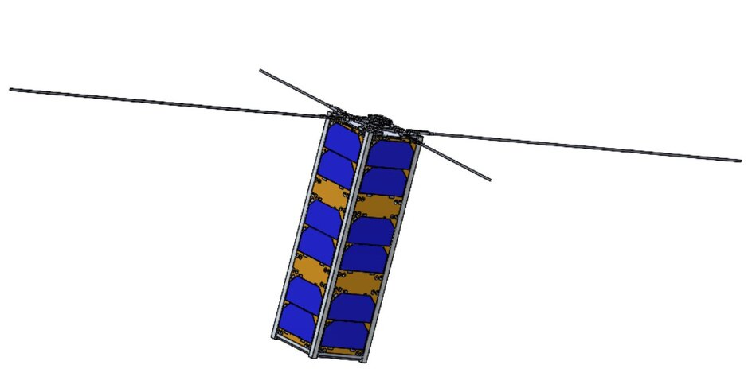

OSPREY is a 3U CubeSat — about the size of a loaf of bread — designed to photograph ocean plastic with a camera sharp enough to pick out plastic within a one-square-metre patch. Power, radio, attitude control, the camera and the structure all have to fit inside a 10 × 10 × 34 cm box and meet the CubeSat standard before anyone will put it on a rocket. I led the mechanical side of that puzzle.

## What I did

- Owned the master CAD model and the packaging: where every board, battery, antenna and the camera sits inside the frame, and how the solar panels deploy — making sure everything fits, clears everything else, and can actually be assembled.
- Calculated the satellite's mass, center of gravity and moments of inertia and kept them within the CubeSat standard, since they decide how well the satellite can point its camera.
- Led a team of six and worked with the power and communications sub-teams to bring their hardware into the design.

  <figure class="figure-wide"><figcaption>OSPREY with its solar arrays and antenna deployed.</figcaption></figure>
  

    <figure class="figure-wide"><figcaption>The mission: image a patch of ocean, send the data down, share it with clean-up crews.</figcaption></figure>
    <figure class="figure-wide"><figcaption>The camera payload.</figcaption></figure>
  

## How it turned out

A complete mechanical design for the satellite, a proposal submitted to NASA's CubeSat Launch Initiative, and $200K raised by the team from alumni and sponsors toward building and launching it. The project is still building toward launch.

  <figure><figcaption>Deployed configuration in CAD.</figcaption></figure>
  <figure><figcaption>Internal layout drawing.</figcaption></figure>
  <figure><figcaption>The internal stack in CAD.</figcaption></figure>
  <figure><figcaption>Mission patch.</figcaption></figure>

