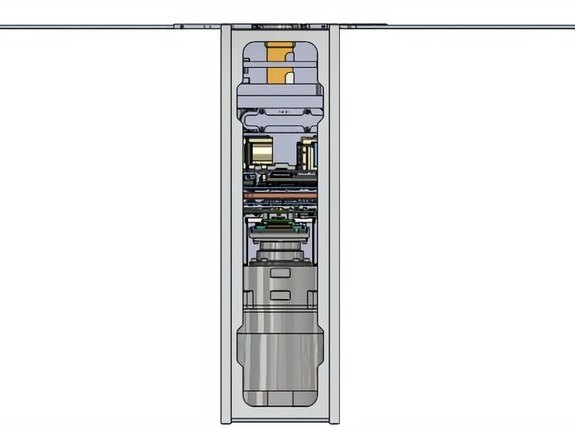
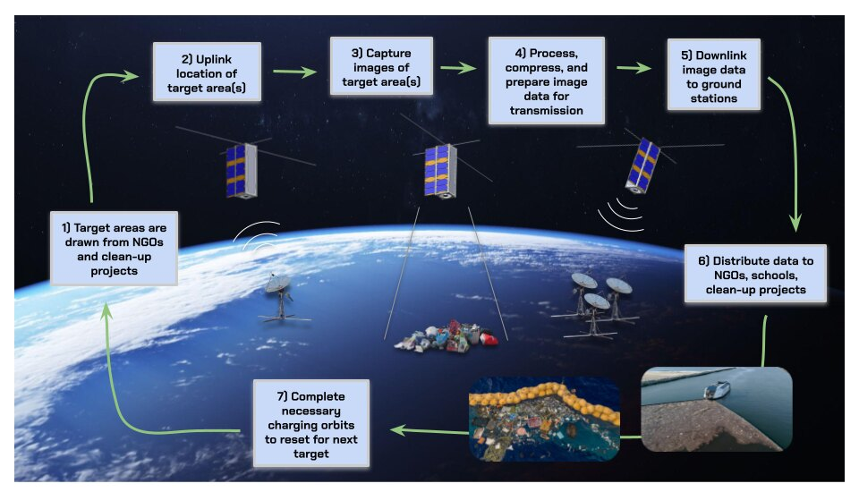
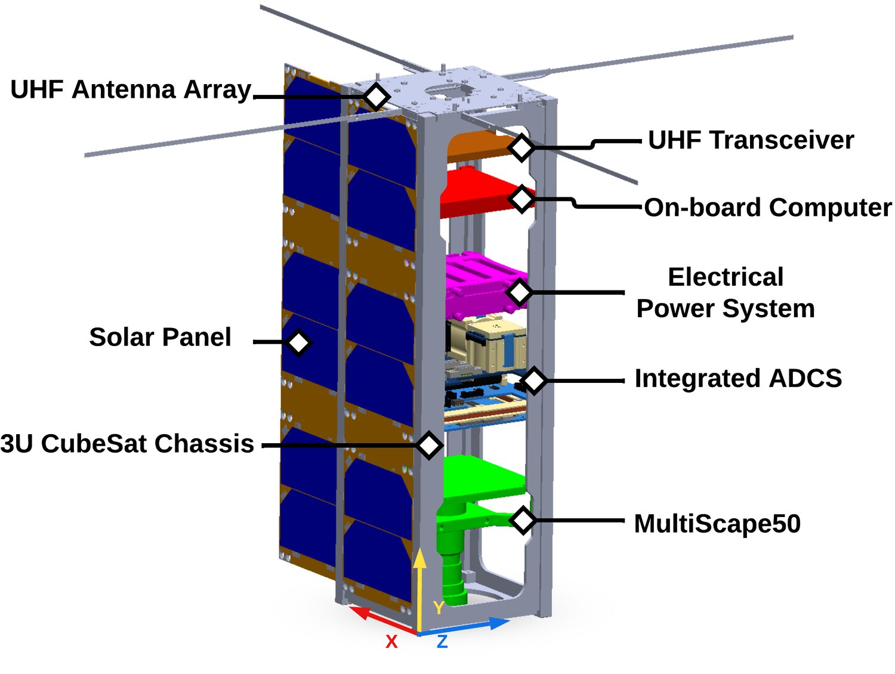
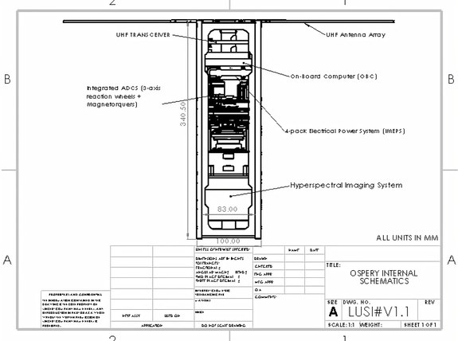
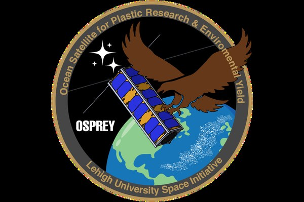

OSPREY is a 3U CubeSat — about the size of a loaf of bread — designed to photograph ocean plastic from orbit. Power, radio, attitude control, the camera and the structure all have to fit inside a 10 × 10 × 34 cm box and meet the CubeSat standard before anyone will put it on a rocket. I led the mechanical side of that puzzle.

## What I did

- Placed every component — boards, batteries, antenna, camera — inside the frame and owned the packaging decisions: what goes where, how it mounts, and how it all comes together at assembly.
- Calculated the satellite's mass, center of mass and moments of inertia, and kept them within the CubeSat standard.
- Looked into what the internals will go through — launch loads and stresses, temperatures, vacuum — and what that means for the layout.
- Led a team of six and worked with the power and communications sub-teams to bring their hardware into the design.

  <figure class="figure-wide"><figcaption>The internal stack in CAD — the current design.</figcaption></figure>
  <figure class="figure-wide"><figcaption>The mission: image a patch of ocean, send the data down, share it with clean-up crews.</figcaption></figure>

## How it turned out

A complete mechanical design for the satellite, a proposal submitted to NASA's CubeSat Launch Initiative, and $200K raised by the team from alumni to send it to space. The project is still building toward launch.

<i class="fas fa-file-pdf" aria-hidden="true"></i> <a href="https://drive.google.com/file/d/1HFVFsZO4rLd7KPLPyvk-KGtrsIB6pKq9/view">Mission overview (PDF)</a> · <a href="https://drive.google.com/file/d/1w6wW3RTmR0EpDcipo0eHy4nWQiP7tt0C/view">NASA CSLI proposal (PDF)</a> · <a href="https://engineering.lehigh.edu/news/article/lehigh-cubesat-secures-federal-funding-and-spaceflight-mentorship">Lehigh Engineering news story</a>

  <figure><figcaption>Component layout as submitted in the CubeSat Launch Initiative proposal (December 2025).</figcaption></figure>
  <figure><figcaption>Internal layout drawing.</figcaption></figure>
  <figure><figcaption>Mission patch.</figcaption></figure>

