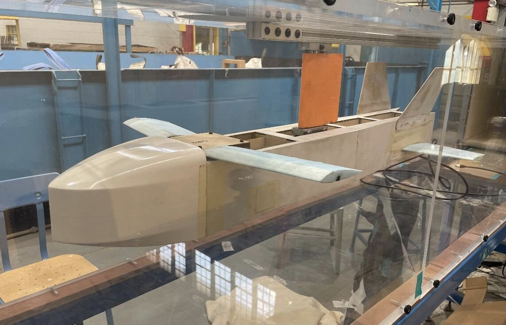
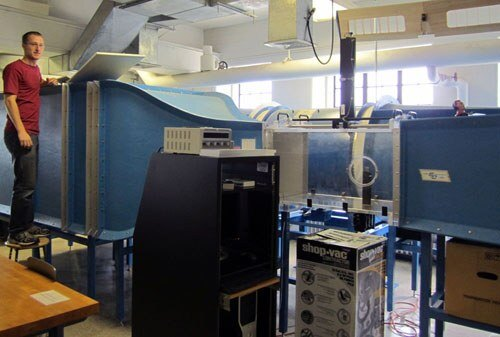
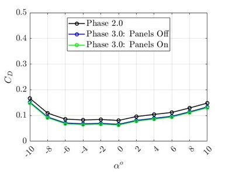
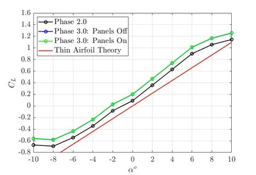
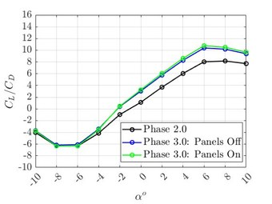

Aerotargets builds target drones for training, and they wanted real numbers on how their airframe performs before changing the design. Our lab ran a three-phase wind-tunnel program for them; I worked on the largest-scale phase — a one-third-scale fuselage model tested with its panels on and off at speeds up to 84 mph.

## What I did

- Scaled and modified the model in SolidWorks to fit the tunnel and the force sensor, and designed the fixture that holds it — with a four-bar linkage so the test angle can be changed without re-rigging the whole setup.
- Mounted the model on a six-axis force sensor behind a streamlined fairing and ran the speed sweeps, logging the data through NI DAQ and LabVIEW.
- Processed the forces in MATLAB, corrected for the shortened wings, and checked the setup against theory: the measured lift matched the published wing data within a few percent.

  <figure class="figure-wide"><figcaption>The one-third-scale model in the Lehigh tunnel.</figcaption></figure>
  <figure class="figure-wide"><figcaption>The tunnel and data-acquisition station.</figcaption></figure>

## How it turned out

The lift was already as good as theory says it can be, so the only way to fly more efficiently was less drag. The fuselage-panel changes we recommended to Aerotargets' engineers lowered drag and raised the lift-to-drag ratio by about ten percent.

  <figure><figcaption>Drag versus angle of attack, panels on and off.</figcaption></figure>
  <figure><figcaption>Lift follows the theory line — so the gains had to come from drag.</figcaption></figure>
  <figure><figcaption>Lift-to-drag ratio across the test phases.</figcaption></figure>

