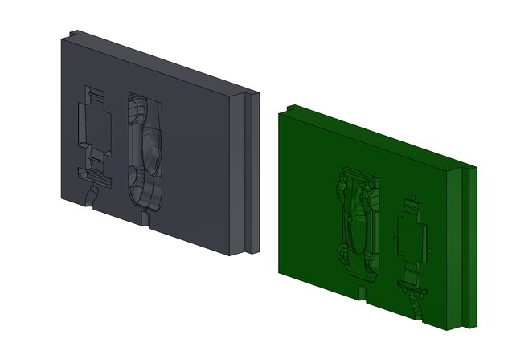
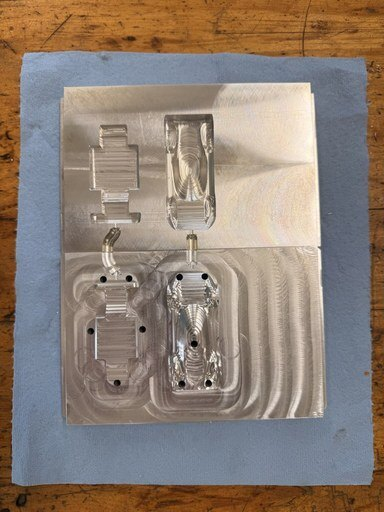
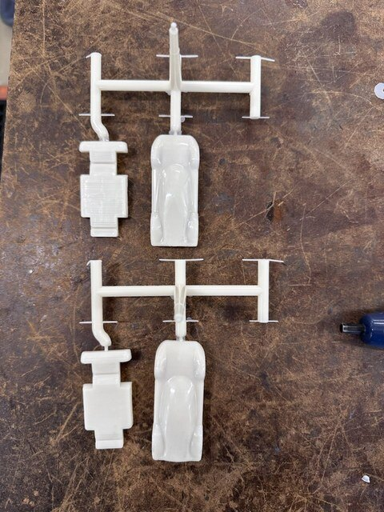
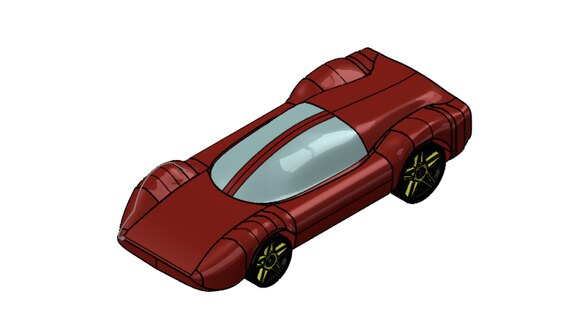
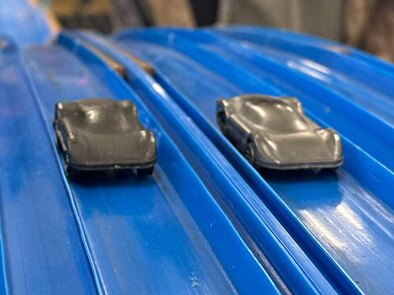
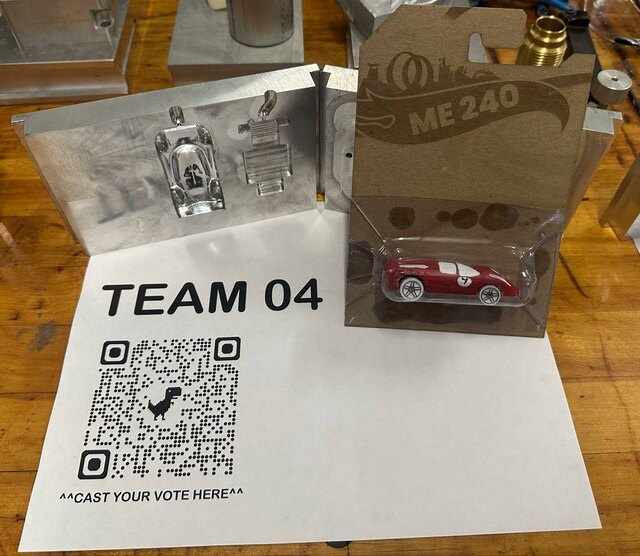

Injection molding is where a design meets the realities of making it: draft angles, wall thickness, where the plastic enters, where it meets itself, how the part comes out. In the manufacturing course my team designed a race-car body, designed the two-part aluminum mold to make it, cut the mold ourselves and molded the parts — then raced the cars.

## What I did

- Modeled the part and the mold in SolidWorks, with draft on every face, even walls, and the gate and runner system that feeds the plastic in.
- Machined the mold by CNC and waterjet, keeping the two halves aligned so the part ejects cleanly.
- Ran the molding trials, checked the parts for consistency, and tuned the process.

  <figure><figcaption>The two mold halves in CAD.</figcaption></figure>
  <figure><figcaption>The machined mold.</figcaption></figure>
  <figure><figcaption>Fresh out of the press, still on the runner.</figcaption></figure>
  <figure><figcaption>The body in CAD.</figcaption></figure>
  <figure><figcaption>Finished cars on the track.</figcaption></figure>
  <figure><figcaption>Our display: mold, parts and the finished car.</figcaption></figure>

## How it turned out

Consistent parts with a clean finish and clean release, cycle after cycle — and our car placed fourth in the class race.
