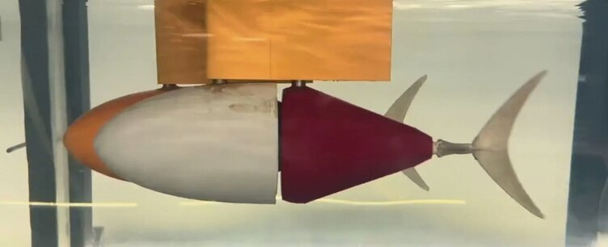
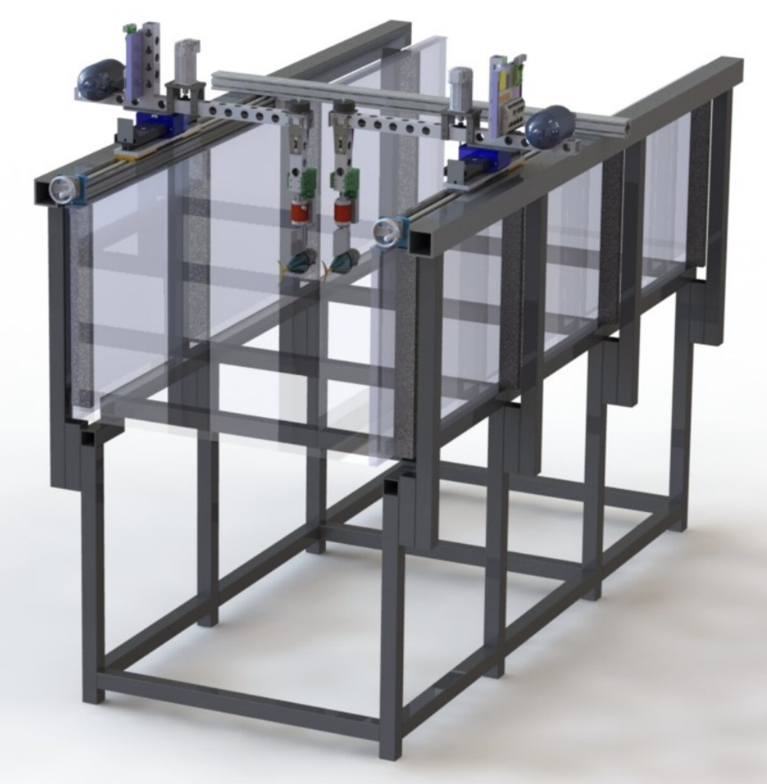
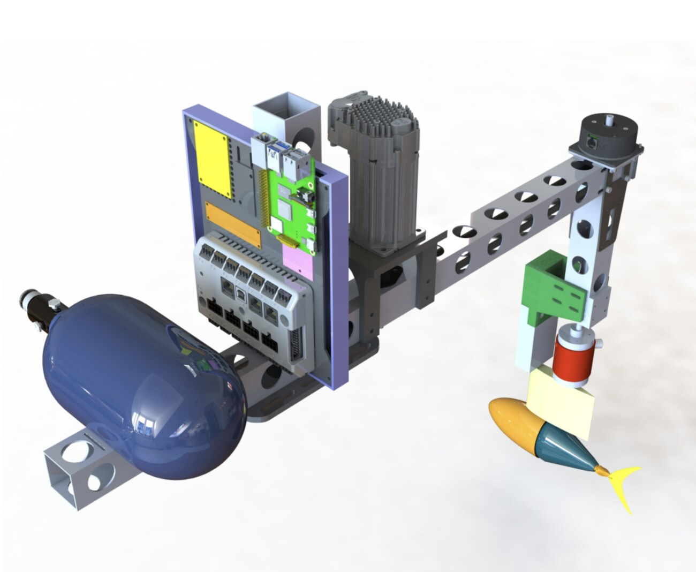

The lab's two TunaBot robotic fish swim one behind the other in the water channel, each on its own carriage so we can set the spacing and the timing between their tail beats precisely. It's the actively swimming version of the question I worked on at Harvard: how does a follower use the wake of the fish in front?

## What I did

- Ran both robots through Arduino with MATLAB/Simulink and an NI DAQ keeping the control and the measurements in sync, including trials with the tails beating in phase and out of phase.
- Captured the wake between the two fish with PIV and processed the flow fields in MATLAB.
- Helped build and calibrate the new wire-free air-bearing platform the carriages ride on — aligning the rails, cleaning the bearings, and dialing in the accuracy a nearly frictionless platform needs.

  <figure><figcaption>TunaBot in the channel.</figcaption></figure>
  <figure><figcaption>Two independent carriages above the channel.</figcaption></figure>
  <figure><figcaption>Each carriage has its own motor, controller and computer.</figcaption></figure>

## How it turned out

Wake flow fields between leader and follower across the different timings, compared with the passive 3-D printed fish experiments — all feeding the same Navy-funded research program as the Harvard work.
