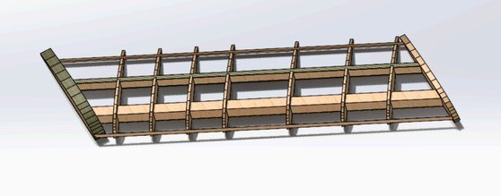
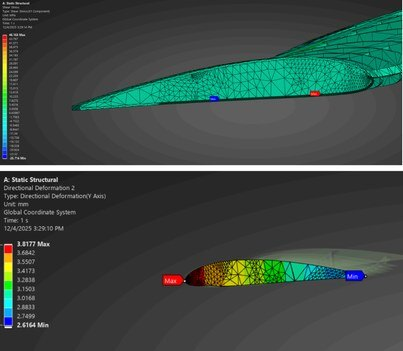
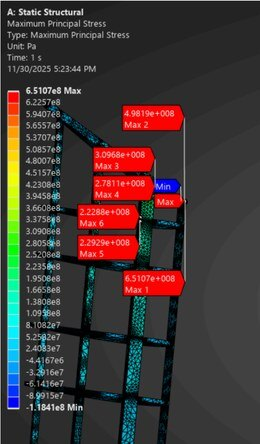
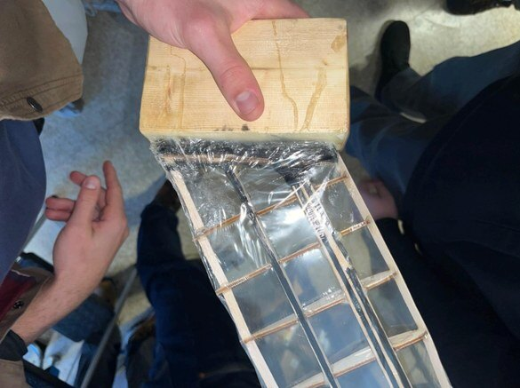
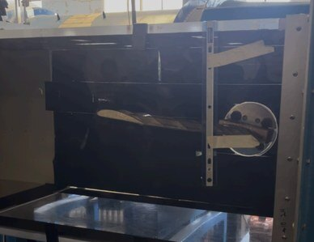
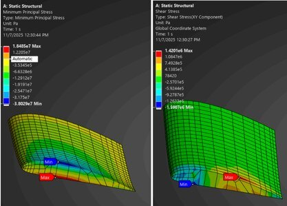

Every gram you take out of a wing makes it fly more efficiently — until the wing gets so flexible that the airflow twists it further and further and it fails. We compared three balsa wing designs (straight, swept-forward, and a rib-and-strut structure) to find that limit, predicted it, and then put a wing in the wind tunnel to see.

## What I did

- Modeled the wings in SolidWorks and ran ANSYS for deflection and stress under the lift load.
- Worked out twist, torsional stiffness and the speed at which each design goes unstable in MATLAB.
- Laser-cut the rib-and-strut wing, reinforced the critical spots with carbon fiber and epoxy, and tested it in the wind tunnel.

  <figure><figcaption>The rib-and-strut design.</figcaption></figure>
  <figure><figcaption>Stress and deflection under load.</figcaption></figure>
  <figure><figcaption>Stress in the rib structure.</figcaption></figure>
  <figure><figcaption>The built wing with carbon-fiber reinforcement.</figcaption></figure>
  <figure><figcaption>In the tunnel.</figcaption></figure>
  <figure><figcaption>Skin stress distribution.</figcaption></figure>

## How it turned out

Cutting the weight aggressively dropped the wing's stiffness by about 98% and brought its instability speed down to 26 m/s. In the tunnel the root joint — where the bending is highest — gave way first at roughly 90 mph, right where the analysis said the weak point would be.
