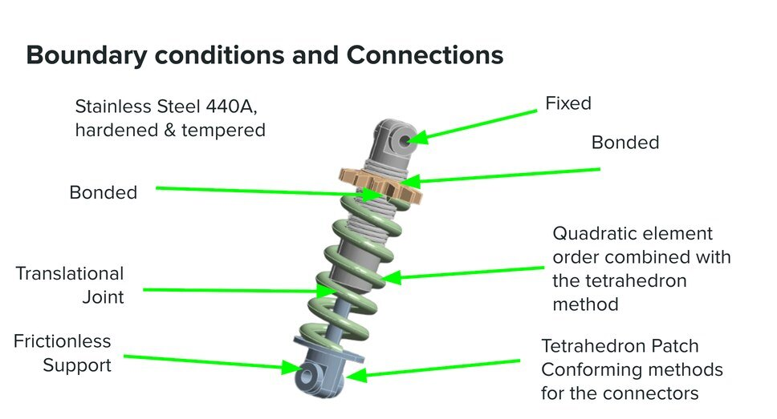
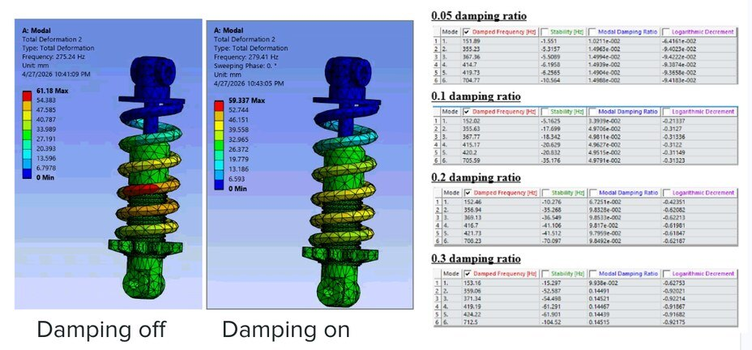

A shock absorber is a small assembly with everything that makes simulation tricky: parts that slide, parts that are fixed together, a spring, and boundary conditions that decide whether the answer means anything. The goal was to find its natural frequencies, see how damping changes the response, and check how real road roughness excites it.

## What I did

- Set up the ANSYS model with the right kind of connection at each interface — fixed, bonded, sliding — and a fine quadratic mesh, then swept the damping ratio from light to heavy.
- When the first results came out wrong, traced it to a bonded contact that should have been a sliding joint, and fixed the model.
- Ran a random-vibration analysis with standard road-roughness profiles at 22 and 60 mph.

  <figure><figcaption>How each part is held or allowed to move.</figcaption></figure>
  <figure><figcaption>Mode shapes with damping off and on.</figcaption></figure>

## How it turned out

The natural frequencies came out between about 150 and 700 Hz, and more damping made the vibration die out faster without moving them much — the behavior is set by the mass and the spring, not the damper. Under road inputs the spring coils were the most stressed part.
