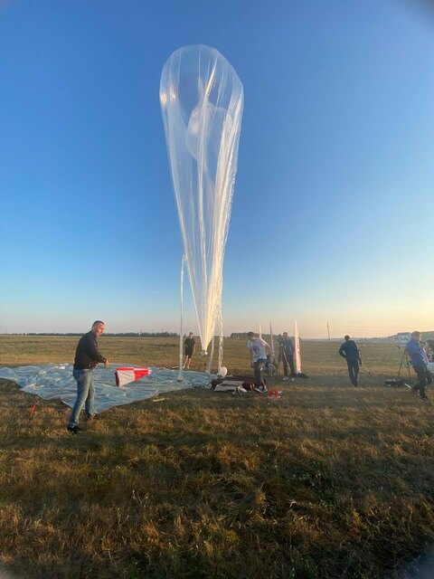
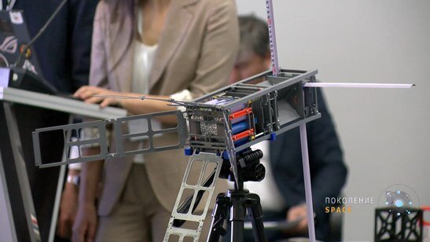
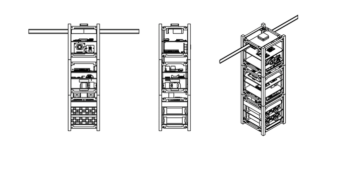
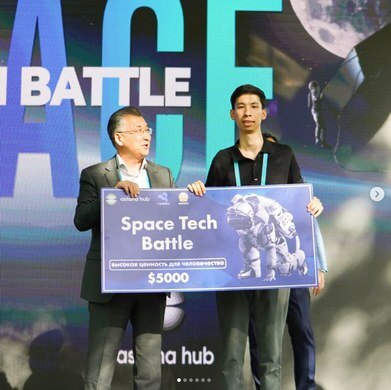
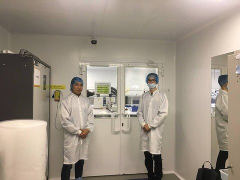
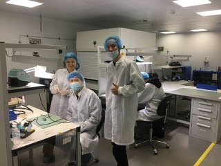

Before Lehigh I founded SkillSat, a small startup that makes kits for students to build their own satellite and fly it to the stratosphere. Schools in Kazakhstan had no hands-on way to teach space engineering, and the commercial kits were expensive and never actually flew. The challenge was a kit a school could afford that would survive a balloon flight to 40 km and come back with data.

## What I did

- Built the satellite systems on Arduino and Raspberry Pi and went through more than 25 3-D printed prototypes.
- Redesigned the kit for low cost and for assembly by students — fewer parts, printable geometry, steps a teenager can follow — which cut the production cost by 44%.
- Tested the prototypes at the National Space Center of Kazakhstan and flew them on stratospheric balloons.

  <figure><figcaption>Launch day.</figcaption></figure>
  <figure><figcaption>A kit with its panels deployed.</figcaption></figure>
  <figure><figcaption>The kit structure.</figcaption></figure>
  <figure><figcaption>Space Tech Battle at Astana Hub.</figcaption></figure>
  <figure><figcaption>At the National Space Center of Kazakhstan.</figcaption></figure>
  <figure><figcaption>In the lab.</figcaption></figure>

## How it turned out

The kits flew to over 40 km. We raised $15K, delivered 80+ kits to 240+ students across 25+ schools, won a $5,000 prize at Astana Hub's Space Tech Battle, and Forbes Kazakhstan listed SkillSat among its Top-3 SpaceTech and Top-15 EdTech startups.
